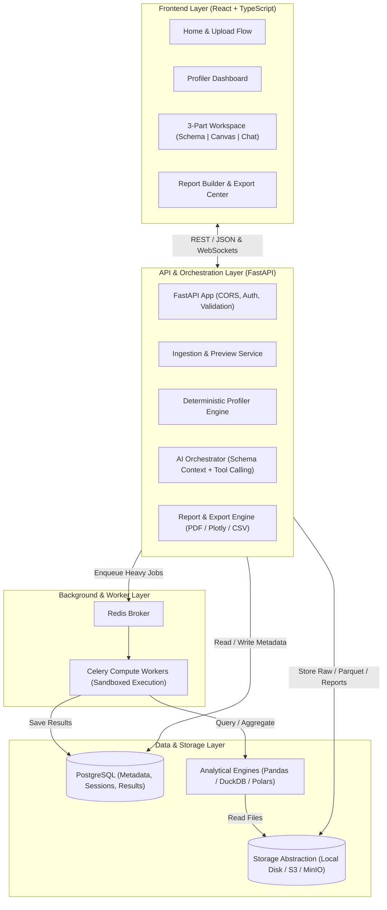
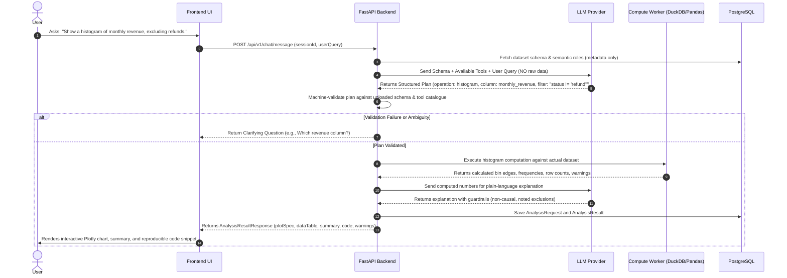

> **Note (v1.0.0):** this document is the original design plan. Where it mentions Celery/Redis, DuckDB/Polars or S3 storage, the shipped implementation differs: background work uses an in-process bounded job runner with database-persisted status, analytics use pandas/scipy/scikit-learn, and only local file storage is implemented. See the top-level `README.md` and `IMPLEMENTATION_REPORT.md` for what actually exists.

# EDAgent System Architecture Documentation

## 1. Architectural Overview

EDAgent is an AI-assisted Exploratory Data Analysis (EDA) platform built on the core principle of **deterministic computation, AI-guided analysis, and transparent, reproducible outputs**. The platform couples an automatic dataset profiling engine with natural language analysis where calculations are never hallucinated by a Large Language Model (LLM), but executed against tabular datasets by Python, DuckDB, or Polars compute workers.

---

## 2. Layer Responsibilities

| Layer | Technologies | Responsibilities |
| :--- | :--- | :--- |
| **Frontend** | React 18, TypeScript, Tailwind CSS, Plotly.js | Upload flow, automatic profile visualization, 3-part interactive analysis workspace, downloadable chart canvas, report builder. |
| **API & Backend** | Python 3.11+, FastAPI, Pydantic v2 | Authentication, session isolation, request validation, delimiter sniffing, orchestrating AI structured plans, serving REST endpoints. |
| **Profiler Engine** | Pure Python / Pandas / DuckDB | Schema inference, semantic column-role detection, missingness calculation, duplicate checks, descriptive statistics, quality warnings. |
| **Compute Engine** | Pandas, DuckDB, Polars | Controlled tool execution (histogram, boxplot, correlation, IQR, group-by, crosstab). Column pushdown and lazy evaluation. |
| **AI Orchestration** | OpenAI / Gemini API (Structured Tool Calling) | Interprets natural language questions, extracts validated structured plans, asks clarifying questions, generates plain-language explanations. |
| **Storage Abstraction**| `StorageProvider` (Local FS / MinIO / S3) | Manages uploaded files, Parquet columnar caches, and generated PDF/CSV export artifacts. |
| **Database** | PostgreSQL + SQLAlchemy 2.0 + Alembic | Stores persistent state: Users, Datasets, Dataset Metadata, Sessions, Analysis Requests, Results, Reports, Background Jobs. |
| **Background Processing** | Redis + Celery | Handles asynchronous tasks: large dataset ingestion, heavy profiling, report compilation, job timeouts, cancellation. |

---

## 3. Analysis Request Lifecycle

---

## 4. Large Dataset and Performance Strategy

The platform enforces tiered processing based on dataset volume:

| Workload Tier | Size Range | Strategy |
| :--- | :--- | :--- |
| **Small** | `< 20 MB` | In-memory Pandas computation; synchronous profiling response `< 2s`. |
| **Medium** | `20 MB - 100 MB` | DuckDB / Polars; push down filters and aggregations without full object materialization. |
| **Large** | `> 100 MB` | Asynchronous Celery background jobs; convert original CSV to Parquet; stream columnar scans; user quota checks. |

### Performance Controls:
- **Zero Raw Data in Web Server RAM**: Uploaded files stream directly to storage.
- **Dataset Fingerprinting**: MD5 / SHA-256 checksums cache repeated analyses.
- **Adaptive Sampling**: Preview operations sample representative rows, with clear visual badges indicating sample vs. full-dataset scope.
- **Quotas & Resource Limits**: CPU, memory (2 GB default), and wall-clock execution timeouts (300 seconds default).

---

## 5. Security, Guardrails & Trust Architecture

1. **Deterministic Calculation Boundary**:
   - The LLM **never** calculates numeric figures or invents statistics. Every number shown in the UI is calculated by the backend compute worker.
2. **SSRF Protection (`validate_url_safe`)**:
   - Remote dataset imports resolve hostnames and block RFC 1918 private IPs (`10.0.0.0/8`, `172.16.0.0/12`, `192.168.0.0/16`), loopbacks (`127.0.0.0/8`, `::1`), link-local metadata endpoints (`169.254.169.254`), and non-HTTP protocols.
3. **CSV Formula Injection Defense (`sanitize_csv_cell`)**:
   - Any cell starting with `=`, `+`, `-`, or `@` is prepended with a quote `'` upon export to neutralize spreadsheet execution.
4. **Prompt Injection Resilience**:
   - Tabular cell data is never concatenated directly into LLM system instructions. Sample rows are formatted as passive data blocks, stripping simulated role headers (`System:`, `User:`).
5. **Session & Data Isolation**:
   - Datasets and analysis sessions are bound to unique UUIDs and user credentials. No tenant can view another user's session data.
