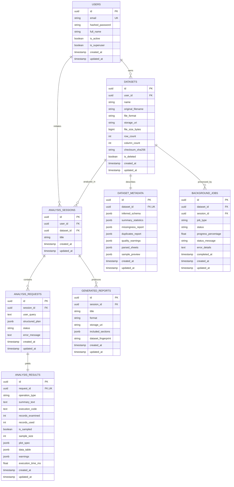

# EDAgent Database Schema Documentation

## 1. Entity-Relationship Overview

All entities utilize **UUIDv4** as primary keys to prevent enumeration attacks and support multi-tenant distributed environments. Time-auditing fields (`created_at`, `updated_at`) are maintained across all major tables.

---

## 2. Table Specifications

### 2.1 `users`
Stores user identities, credentials, and access roles.
- `id` (UUID, Primary Key, Indexed)
- `email` (VARCHAR(255), Unique, Not Null, Indexed)
- `hashed_password` (VARCHAR(255), Not Null)
- `full_name` (VARCHAR(255), Nullable)
- `is_active` (BOOLEAN, Default: `TRUE`, Not Null)
- `is_superuser` (BOOLEAN, Default: `FALSE`, Not Null)
- `created_at` / `updated_at` (TIMESTAMP WITH TIME ZONE)

### 2.2 `datasets`
Tracks uploaded structured files and raw metadata.
- `id` (UUID, Primary Key, Indexed)
- `user_id` (UUID, Foreign Key `users.id` ON DELETE CASCADE, Nullable for demo sessions)
- `name` (VARCHAR(255), Not Null)
- `original_filename` (VARCHAR(255), Not Null)
- `file_format` (VARCHAR(32), Not Null) — `csv`, `tsv`, `xlsx`, `parquet`
- `storage_uri` (VARCHAR(512), Not Null) — Local path or `s3://bucket/key`
- `file_size_bytes` (BIGINT, Not Null)
- `row_count` (INTEGER, Nullable until profiled)
- `column_count` (INTEGER, Nullable until profiled)
- `checksum_sha256` (VARCHAR(64), Not Null, Indexed) — Used for idempotency & caching
- `is_deleted` (BOOLEAN, Default: `FALSE`, Not Null)

### 2.3 `dataset_metadata`
Stores the comprehensive baseline profile outputs without re-reading the raw dataset.
- `id` (UUID, Primary Key, Indexed)
- `dataset_id` (UUID, Foreign Key `datasets.id` ON DELETE CASCADE, Unique, Indexed)
- `inferred_schema` (JSONB, Not Null) — Column names, data types, semantic roles (`identifier`, `measure`, `category`, `datetime`, `boolean`, `text`)
- `summary_statistics` (JSONB, Not Null) — Mean, std, quartiles, median, min, max, unique counts
- `missingness_report` (JSONB, Not Null) — Per-column missing counts and percentages
- `duplicates_report` (JSONB, Not Null) — Exact duplicate count, candidate key list
- `quality_warnings` (JSONB, Not Null) — Constant columns, mixed formats, suspicious values
- `parsed_sheets` (JSONB, Nullable) — List of sheet names for Excel workbooks
- `sample_preview` (JSONB, Nullable) — Head, tail, and random sample rows for fast UI previews

### 2.4 `analysis_sessions`
Isolates a user's conversational inquiry session around a specific dataset.
- `id` (UUID, Primary Key, Indexed)
- `user_id` (UUID, Foreign Key `users.id` ON DELETE SET NULL, Nullable)
- `dataset_id` (UUID, Foreign Key `datasets.id` ON DELETE CASCADE, Not Null, Indexed)
- `title` (VARCHAR(255), Default: `'New Analysis Session'`, Not Null)

### 2.5 `analysis_requests`
Maintains conversational query history and validated analysis plans.
- `id` (UUID, Primary Key, Indexed)
- `session_id` (UUID, Foreign Key `analysis_sessions.id` ON DELETE CASCADE, Not Null, Indexed)
- `user_query` (TEXT, Not Null) — Natural language question asked by user
- `structured_plan` (JSONB, Nullable) — Machine-validated execution plan (operation, column, filter, aggregation)
- `status` (VARCHAR(32), Default: `'PENDING'`, Not Null) — `PENDING`, `RUNNING`, `COMPLETED`, `FAILED`
- `error_message` (TEXT, Nullable)

### 2.6 `analysis_results`
Stores immutable, reusable computation outputs.
- `id` (UUID, Primary Key, Indexed)
- `request_id` (UUID, Foreign Key `analysis_requests.id` ON DELETE CASCADE, Unique, Indexed)
- `operation_type` (VARCHAR(64), Not Null) — e.g. `histogram`, `group_by`, `correlation`, `outlier_iqr`
- `summary_text` (TEXT, Not Null) — Guardrailed plain-language interpretation
- `execution_code` (TEXT, Not Null) — Exact Python / SQL code executed to produce result
- `records_examined` (INTEGER, Not Null)
- `records_used` (INTEGER, Not Null)
- `is_sampled` (BOOLEAN, Default: `FALSE`, Not Null)
- `sample_size` (INTEGER, Nullable)
- `plot_spec` (JSONB, Nullable) — Plotly schema JSON
- `data_table` (JSONB, Nullable) — Result records for export
- `warnings` (JSONB, Not Null) — Assumptions not checked, small group sizes, high missingness
- `execution_time_ms` (FLOAT, Not Null)

### 2.7 `generated_reports`
Archives generated one-click PDF and HTML deliverables.
- `id` (UUID, Primary Key, Indexed)
- `session_id` (UUID, Foreign Key `analysis_sessions.id` ON DELETE CASCADE, Not Null, Indexed)
- `title` (VARCHAR(255), Not Null)
- `format` (VARCHAR(16), Default: `'PDF'`, Not Null) — `PDF` or `HTML`
- `storage_uri` (VARCHAR(512), Not Null)
- `included_sections` (JSONB, Not Null) — List of sections selected by user
- `dataset_fingerprint` (VARCHAR(64), Not Null)

### 2.8 `background_jobs`
Tracks progress and status for long-running operations.
- `id` (UUID, Primary Key, Indexed)
- `dataset_id` (UUID, Foreign Key `datasets.id` ON DELETE SET NULL, Nullable)
- `session_id` (UUID, Foreign Key `analysis_sessions.id` ON DELETE SET NULL, Nullable)
- `job_type` (VARCHAR(64), Not Null) — `PROFILING`, `ANALYSIS`, `REPORT_GENERATION`, `CONVERSION`
- `status` (VARCHAR(32), Default: `'PENDING'`, Not Null, Indexed) — `PENDING`, `PROCESSING`, `SUCCESS`, `FAILURE`, `REVOKED`
- `progress_percentage` (FLOAT, Default: `0.0`, Not Null)
- `status_message` (VARCHAR(255), Default: `'Job enqueued'`, Not Null)
- `error_details` (TEXT, Nullable)
- `completed_at` (TIMESTAMP WITH TIME ZONE, Nullable)

---

## 3. Database Migration Strategy

Database schema evolution is managed via **Alembic**:
- Initial migration script sets up all tables and indexes.
- All foreign keys are indexed for query performance.
- Unique constraints on `users.email` and `datasets.checksum_sha256` ensure integrity.
