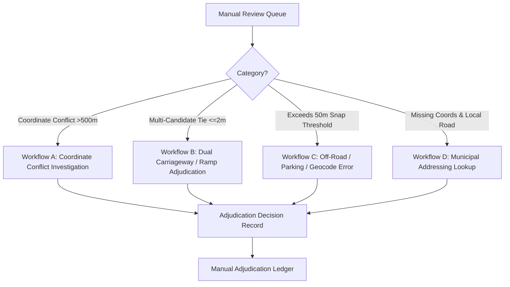

# Roadway Crosswalk Manual Review & Adjudication Guide

> **Superseded scope:** This report records earlier work and decisions. [Project Plan v3](../EDAgent_Project_Plan_v3.pdf) and the [v3 roadmap](../implementation_plan.md#v3-transition-and-roadmap) govern release scope: site-level historical screening, frequency/EB modelling and real-site treatment estimates are out of scope; geographic matches are diagnostic, with zero accepted primary assignments. Earlier claims of approval, mandatory pathways or pending release describe historical proposals, not current authorization.

**Project:** EDAgent — Road-Safety Analytics  
**Version:** 1.0.0  
**Phase:** Phase 3 — Module D  
**Date:** November 2026  
**Audience:** Traffic Safety Engineers, GIS Analysts, Data Stewards  

---

## 1. Overview & Purpose

The automated crosswalk engine resolves crashes into unambiguous primary roadway sites whenever evidence meets rigorous confidence thresholds. However, when spatial evidence is contradictory or competing roadway candidates have equal evidence, records are explicitly preserved as `AMBIGUOUS` or `UNMATCHED` with `primary_site_id = None`.

This guide establishes the standard operating procedure for human analysts to review, investigate, and adjudicate records flagged in:
1. `data/exports/crosswalk/ambiguous_records_review.csv`
2. `data/exports/crosswalk/coordinate_disagreements_review.csv`

---

## 2. Review Categories & Adjudication Workflows

### 2.1 Workflow A: Coordinate Disagreement Review (`FLAGGED_CONFLICT`)
- **Trigger**: Spatial distance between Police DMS coordinates and PennDOT State Route Decimal coordinates exceeds $500\text{ meters}$.
- **Root Cause**: Police officer recorded inaccurate GPS fix (e.g. at hospital, station house, or nearest cell tower) while PennDOT RMS milepost LRS was calculated from physical roadway markers; or vice-versa.
- **Investigation Steps**:
  1. Inspect `ROUTE`, `SEGMENT`, and `OFFSET`. If the crash occurred on a State Route, verify whether the PennDOT State Decimal coordinates align with the recorded State Route corridor.
  2. Inspect `STREET_NAME` and `MUNICIPALITY`. Compare whether the street name corroborates the police GPS point or the state route decimal point.
  3. Cross-reference aerial imagery / GIS orthophotos.
- **Allowed Actions**:
  - `ACCEPT_STATE_LRS`: Police GPS was corrupted/displaced; adopt State Route segment (`SEG:02:SR...`).
  - `ACCEPT_POLICE_GPS`: State Route decimal calculation had erroneous segment/offset entry; snap to verified police GPS location.
  - `RETAIN_UNRESOLVED`: Evidence is irreconcilable; retain `primary_site_id = None`.

### 2.2 Workflow B: Multi-Candidate Tie Review (`EQUIDISTANT_MULTI_CANDIDATE_TIE`)
- **Trigger**: Multiple roadway centerline features are within $2.0\text{ meters}$ distance difference with identical street name corroboration.
- **Typical Setting**: Divided multi-lane highways (e.g., I-376, I-79, SR 28) with parallel directional carriageways, or closely spaced mainline and collector-distributor ramps.
- **Investigation Steps**:
  1. Check directional indicators in crash report (`TRAVEL_DIRECTION`, vehicle movement codes).
  2. Check PennDOT segment numbering:
     - Even segment numbers (`0010`, `0020`, `0030`) indicate **Northbound / Eastbound** travel.
     - Odd segment numbers (`0011`, `0021`, `0031`) indicate **Southbound / Westbound** travel.
  3. Verify ramp designation (`RAMP` road class or 8000-series route numbers).
- **Allowed Actions**:
  - `ASSIGN_DIRECTIONAL_SEGMENT`: Assign to specific directional segment ID based on verified travel direction.
  - `COLLAPSE_TO_CORRIDOR`: If direction is unrecorded, assign to bidirectional corridor-level grouping.

### 2.3 Workflow C: Spatial Distance Exceeded (`EXCEEDS_MAX_ROAD_SNAP_DISTANCE`)
- **Trigger**: Distance from crash coordinates to nearest public centerline exceeds $50.0\text{ meters}$.
- **Typical Setting**: Shopping plaza parking lots, private driveways, highway rest stops, off-road vehicle rollovers down embankments, or geocoding truncation errors.
- **Investigation Steps**:
  1. Check `RELATION_TO_ROAD` and `LOCATION_TYPE`. If flagged as non-roadway, parking lot, or private property, the crash does not belong on a public road segment.
  2. Inspect satellite imagery for private roads or newly constructed subdivision streets not yet captured in the reference centerline vintage.
- **Allowed Actions**:
  - `CONFIRM_NON_MAINTAINED`: Confirmed private lot or off-road location; remain `UNMATCHED`.
  - `LINK_TO_ACCESS_DRIVE`: Snap to public intersection or segment where parking lot driveway meets the public roadway network.

### 2.4 Workflow D: Missing Coordinates on Local Roads (`UNMATCHED_MISSING`)
- **Trigger**: Crash coordinates are missing/zeroed, and no State Route LRS identifiers exist.
- **Investigation Steps**:
  1. Check `STREET_NAME`, intersecting approach names, and `MUNICIPALITY`.
  2. Query County addressing database or municipal parcel boundary index.
- **Allowed Actions**:
  - `MANUAL_GEOCODE`: Derive intersection or segment ID from verified municipal address block.
  - `RETAIN_UNMATCHED`: Insufficient street address details; remain `UNMATCHED`.

---

## 3. Strict Separation of Machine Matches & Manual Decisions

To protect scientific integrity and reproducibility:
1. **Immutable Machine Crosswalk**: `crosswalk_v1.0.0.csv.gz` remains strictly machine-generated and read-only.
2. **Manual Adjudication Ledger**: All human reviewer decisions must be stored in a separate table: `data/exports/crosswalk/manual_adjudication_ledger.csv`.
3. **Ledger Schema**:
   - `crash_id` (Integer)
   - `original_match_status` (String)
   - `adjudicated_site_id` (String)
   - `adjudicated_match_method` (`MANUAL_ADJUDICATION`)
   - `reviewer_id` (String)
   - `review_timestamp` (ISO 8601 UTC)
   - `evidence_source` (e.g. `PennDOT_Police_Crash_Report_Narrative`, `Aerial_Orthophoto_2026`)
   - `rationales` (Text description of justification)
4. Any downstream analysis consuming manual overrides must join the base machine crosswalk with the manual adjudication ledger through explicit, documented versioning.
