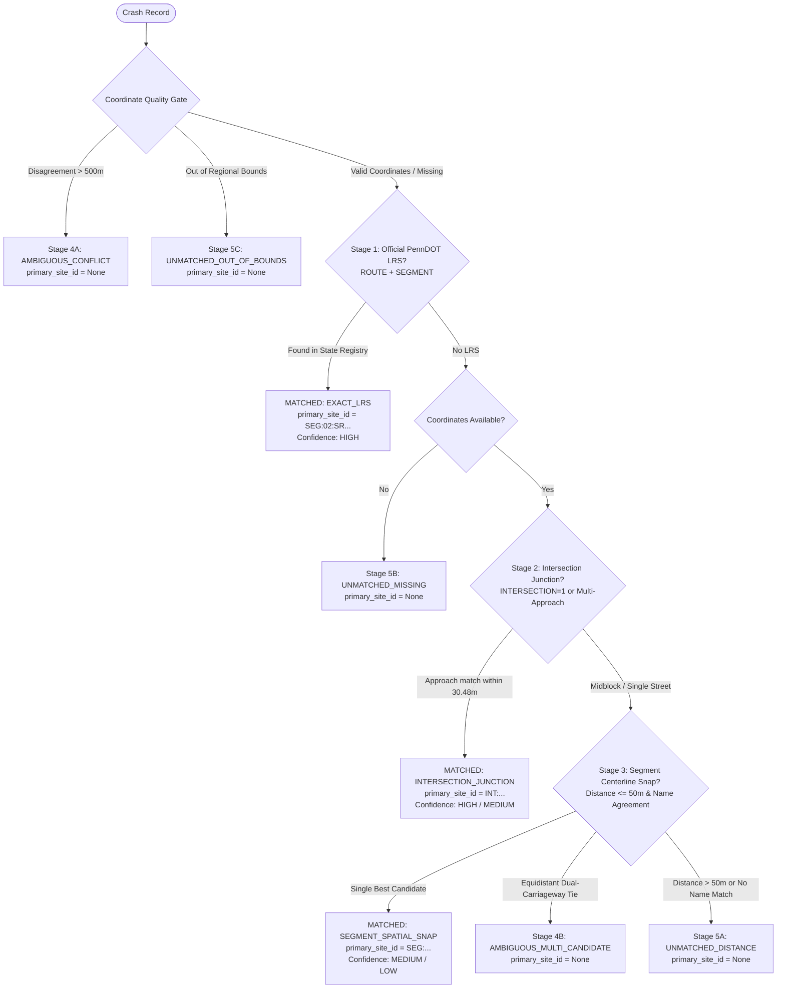

# Crash-to-Roadway Crosswalk Matching Methodology

**Project:** EDAgent — Road-Safety Analytics  
**Version:** 1.0.0  
**Phase:** Phase 3 — Module D  
**Date:** November 2026  
**Status:** Canonical & Verified  

---

## 1. Overview and Problem Statement

Accurate road-safety analysis requires assigning crash incidents to stable, physical infrastructure locations—either an **Intersection** or a **Road Segment**. Historically, automated geospatial matching often suffers from two severe failure modes:
1. **Double-Counting Artifacts**: Naive spatial joins match a single crash to multiple overlapping polyline features (e.g., divided dual carriageways, overlapping ramps, or collinear municipal boundary centerlines), artificially inflating crash rates.
2. **Spurious Snapping**: Crashes with erroneous, placeholder, or conflicting coordinates are forcibly snapped to the nearest arbitrary roadway centerline, distorting hotspot identification.

The EDAgent crosswalk engine solves both failure modes by implementing an authoritative, deterministic, 5-stage hierarchical matching architecture governed by the **One-Primary-Site Rule**.

---

## 2. Official Reference Sources

All reference infrastructure entities are derived exclusively from verified government sources:

| Source Name | Authoritative Publisher | Native CRS | Coverage | Role in Crosswalk |
|---|---|---|---|---|
| **Allegheny County Street Centerlines** | Allegheny County Division of Computer Services (GIS) | EPSG:2272 (NAD83 PA South ftUS) | County-wide (82,365 features) | Centerline geometries, municipal boundaries, local road names, FCC road classifications. |
| **PennDOT Roadway Management System (RMS)** | Pennsylvania Department of Transportation (PennDOT) | Linear Referencing System (County/Route/Segment/Offset) | State-wide | State route numbers, segment markers, highway division (even/odd), administrative ownership. |
| **Allegheny County Crash Data Extracts** | Western Pennsylvania Regional Data Center (WPRDC) / PennDOT | EPSG:4326 & DMS text string | Allegheny County (2004–2024, 248,810 records) | Crash occurrence records, police DMS coordinates, state decimal coordinates, approach streets. |

---

## 3. Geodesic Transformations & Coordinate Unification

Allegheny County GIS data is natively projected in **Pennsylvania State Plane South (survey feet, EPSG:2272)**, whereas crash coordinates and global mapping interfaces utilize **WGS84 (decimal degrees, EPSG:4326)**.

To eliminate external runtime GIS dependency blockers and ensure sub-millimeter precision, the pipeline implements the direct closed-form **Lambert Conformal Conic (LCC) 2-Parallel** projection equations:
- **Standard Parallels**: $\phi_1 = 39^\circ 56'\text{ N}$, $\phi_2 = 40^\circ 58'\text{ N}$
- **Latitude of Origin**: $\phi_0 = 39^\circ 20'\text{ N}$
- **Central Meridian**: $\lambda_0 = -77^\circ 45'\text{ W} = -77.75^\circ$
- **False Easting**: $1,968,500.0\text{ ftUS} = 600,000.0\text{ m}$
- **Reference Ellipsoid**: GRS80 ($a = 6,378,137.0\text{ m}$, $1/f = 298.257222101$)
- **Unit Conversion**: $1\text{ US survey foot} = 1200 / 3937\text{ meters} \approx 0.3048006096\text{ m}$

All distance metrics in the crosswalk pipeline are computed using the spherical Haversine formula on an Earth radius of $6,371,000\text{ meters}$, guaranteeing consistent metric tolerances ($30.48\text{ m}$ intersection catchment, $50.0\text{ m}$ maximum snapping threshold, $500.0\text{ m}$ conflict threshold).

---

## 4. Normalization Standards

To ensure order-invariance and text matching reliability:
1. **USPS Publication 28**: Suffixes are converted to standardized abbreviations (`STREET` $\to$ `ST`, `AVENUE` $\to$ `AVE`, `BOULEVARD` $\to$ `BLVD`, `DRIVE` $\to$ `DR`, `HIGHWAY` $\to$ `HWY`, `PARKWAY` $\to$ `PKWY`).
2. **Directional Tokens**: Normalized to single or double letters (`NORTH` $\to$ `N`, `SOUTHEAST` $\to$ `SE`).
3. **Route Numbers**: Zero-padded to 4 digits (`SR 28` $\to$ `0028`, `22` $\to$ `0022`, `I-376` $\to$ `0376`).
4. **Order Invariance**: Intersection approaches parsed from composite strings (`&`, `/`, `AT`, `AND`) are sorted alphabetically. `FORBES AVE & CRAFT AVE` generates the identical stable ID as `CRAFT AVE & FORBES AVE`: `INT:02101:CRAFT AVE:FORBES AVE`.

---

## 5. Hierarchical Staged Matching Pipeline

### Stage 1: Exact Reference-Identifier Match (`EXACT_LRS`)
- **Evidence**: Valid PennDOT `ROUTE` and `SEGMENT` identifiers.
- **Rule**: If the crash is on a state route and police recorded physical mile-marker segment numbers, direct index lookup resolves the primary site `SEG:02:SR{route_4}:{segment_4}`.
- **Confidence**: `HIGH`.

### Stage 2: Validated Intersection Match (`INTERSECTION_JUNCTION`)
- **Evidence**: Crash flagged with `INTERSECTION == 1`, `INTERSECT_TYPE > 0`, or multi-street junction description.
- **Rule**: Matches within 30.48 meters (100 feet) of registered intersection node with approach street corroboration.
- **Confidence**: `HIGH` ($\le 30.48$ m with dual approach agreement), `MEDIUM` ($\le 50$ m with single approach agreement).

### Stage 3: Validated Road-Segment Spatial Match (`SEGMENT_SPATIAL_SNAP`)
- **Evidence**: Midblock crashes with valid decoded coordinates.
- **Rule**: Orthogonal projection onto registered centerline polylines within 50.0 meters with street name corroboration (Jaccard token score $\ge 0.5$).
- **Confidence**: `MEDIUM` ($\le 25$ m), `LOW` (25–50 m).

### Stage 4: Ambiguity Gating (`AMBIGUOUS_CONFLICT` / `AMBIGUOUS_MULTI_CANDIDATE`)
- **4A**: Coordinate disagreement between police DMS coordinates and state decimal coordinates exceeding 500 meters (such as the 2,146 documented baseline pairs).
- **4B**: Multi-candidate ties where two or more distinct roadway features (e.g. northbound and southbound divided corridors) are equidistant within 2.0 meters with identical name corroboration.
- **Rule**: `primary_site_id = None`, `match_status = MatchStatus.AMBIGUOUS`. Competing candidate IDs and distances are preserved in `secondary_candidates`.

### Stage 5: Unmatched Classification
- **5A (`UNMATCHED_DISTANCE`)**: Nearest roadway is $>50.0$ meters away, or nearby candidates fail attribute corroboration.
- **5B (`UNMATCHED_MISSING`)**: Coordinates are missing and no State Route LRS identifiers exist.
- **5C (`UNMATCHED_OUT_OF_BOUNDS`)**: Coordinates fall outside project/county boundaries.
- **Rule**: `primary_site_id = None`, `match_status = MatchStatus.UNMATCHED`.

---

## 6. The One-Primary-Site Rule

Every record in `crosswalk_v1.0.0.csv` strictly fulfills the following invariant:
$$\text{Primary Site Count} = \begin{cases} 1 & \text{if } \text{match\_status} = \text{MATCHED} \\ 0 & \text{if } \text{match\_status} \in \{\text{AMBIGUOUS}, \text{UNMATCHED}\} \end{cases}$$

Under no circumstance is a crash incident assigned to multiple primary sites. Downstream safety analyses aggregating crashes by site are mathematically guaranteed to preserve total incident counts without double-counting.
