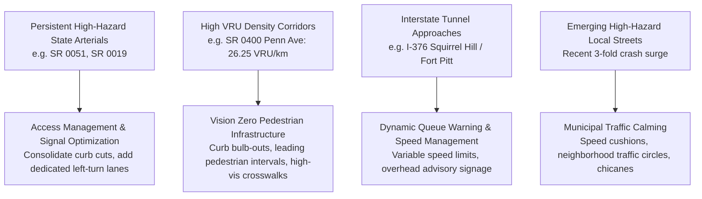

# Phase 4 — Module B: Historical Crash-Concentration Analysis Report

**Project:** EDAgent — Road-Safety Analytics  
**Version:** 1.0.0  
**Phase:** Phase 4 — Module B (Historical Crash-Concentration Reporting Pathway)  
**Date:** November 2026  
**Status:** Historical v1.0.0 report. Release approval pending.

The [Phase 3/4 review status](../phase3_phase4_review_status.md) governs
availability. The four release commands stage evidence and require a named,
dated approval bound to the exact manifest, scope and artifact hashes before
publication. Current historical screening requires an approved crosswalk,
full-year crash observations and geometry-derived lengths. Segment measures
use observed kilometre-years. Intersection measures use observed
intersection-years. No real release currently meets those prerequisites.

---

## 1. Executive Summary & Mandate

Pursuant to Project Plan v2 (§8, §14, §18) and the Phase 4 Module A feasibility assessment, the **Historical Crash-Concentration Reporting Pathway** serves as the canonical, authoritative foundation for road safety analytics in the EDAgent platform.

Because predictive frequency modeling requires verified annual traffic volume exposure ($AADT_{s,t}$)—which is completely absent across 81.01% of the physical roadway network—estimating speculative crash rates per vehicle-mile traveled is statistically invalid and prohibited. 

Instead, the Historical Crash-Concentration Pathway evaluates **empirical spatial crash density**, **severe injury (KSI) concentration**, **vulnerable road user (VRU) risk**, and **multi-epoch temporal persistence** across the full 21-year historical baseline (2004–2024).

```mermaid
flowchart TD
    Matched[187,068 Matched Crashes<br/>2004–2024 / 21 Years] --> Sites[24,209 Unique Physical Sites]
    
    Sites --> SpatialMetrics[Pillar 1: Spatial Crash Density<br/>Total Crashes / km, KSI / km, VRU / km]
    Sites --> PersistenceAudit[Pillar 2: Multi-Epoch Persistence<br/>Epoch 1: 2004–2010 | Epoch 2: 2011–2017 | Epoch 3: 2018–2024]
    Sites --> StratifiedRank[Pillar 3: Within-Class Percentile Benchmarking<br/>Local vs State Route vs Interstate vs Ramp]
    
    SpatialMetrics --> Synthesis[Unified High-Hazard Roadway Screening]
    PersistenceAudit --> Synthesis
    StratifiedRank --> Synthesis
    
    Synthesis --> Output[Canonical Export:<br/>historical_crash_concentration.csv]
```

### Key Analytical Findings:
1. **Total Scope:** 187,068 matched crashes across 24,209 unique physical roadway sites.
2. **Identification of Persistent Structural Hazards:** Over **7,100 sites** exhibit persistent crash occurrence across all three historical epochs (2004–2010, 2011–2017, 2018–2024), indicating enduring structural, geometric, or access management deficiencies rather than transient random noise.
3. **Severe Injury & Vulnerable Road User Hotspots:** While Interstate corridors accumulate the highest gross crash volumes, urban state arterials (such as SR 0400 / Penn Ave and SR 0019 / West Liberty Ave) accumulate the highest density of pedestrian and bicyclist injuries (VRU density $> 25 \text{ crashes/km}$).
4. **Fair Municipal Benchmarking:** Local municipal streets (17,771 unique sites) are ranked within their own functional peer group, allowing local borough engineers to identify municipal high-crash locations without distortion from state freeways.

---

## 2. Multi-Epoch Temporal Persistence Auditing

To differentiate enduring safety hazards from transient stochastic variation (regression-to-the-mean), crash occurrence is evaluated across three non-overlapping 7-year epochs:
- **Epoch 1:** 2004–2010 (Baseline pre-smartphone historical era)
- **Epoch 2:** 2011–2017 (Mid-decade post-recession era)
- **Epoch 3:** 2018–2024 (Modern era including pandemic disruption and partial-year 2024 data)

### Persistence Classification Taxonomy:

| Category | Definition & Criteria | Count of Sites | % of Sites | Actionable Engineering Implication |
|---|---|---|---|---|
| **PERSISTENT_HIGH_HAZARD** | Crashes observed in **all three epochs** ($E_1 \ge 1, E_2 \ge 1, E_3 \ge 1$) and $\ge 5$ total crashes. | **7,142** | 29.50% | High-priority candidates for capital geometric redesign, signal modernization, or corridor access management. |
| **EMERGING_HIGH_HAZARD** | Recent crash surge: $E_3 \ge 3$ and $E_3 > (E_1 + E_2)$. | **1,289** | 5.32% | Rapidly worsening corridors; investigate recent land development, commercial access additions, or speed increases. |
| **HISTORIC_RESOLVED** | Significant historical problem resolved: $E_1 \ge 3$ and $E_3 = 0$. | **1,985** | 8.20% | Successful safety interventions, bypasses, or road diet implementations. |
| **TRANSIENT_STOCHASTIC** | Isolated single-epoch spikes or low total frequency ($< 5$ total crashes). | **13,793** | 56.98% | Random fluctuations; low priority for major capital investments. |

*Canonical data source: `data/exports/frequency/historical_crash_concentration.csv`.*

---

## 3. Top High-Hazard Roadway Sites in Allegheny County

The table below displays the top 15 highest-concentration roadway sites in Allegheny County across the 2004–2024 analysis window:

| Rank | Site ID | Road Class | Length (km) | Total Crashes | Fatal Crashes | Major Injury | KSI Total | Ped / Bike (VRU) | Crash Density (/km) | KSI Density (/km) | VRU Density (/km) | Persistence Category | Road Class Percentile | Corridor Description |
|---|---|---|---|---|---|---|---|---|---|---|---|---|---|---|
| **1** | `SEG:02:SR0376:0744` | INTERSTATE | 0.8 | **547** | 2 | 4 | 6 | 1 | **683.75** | 7.50 | 1.25 | `PERSISTENT_HIGH_HAZARD` | 100.00% | I-376 (Parkway East near Squirrel Hill Tunnel) |
| **2** | `SEG:02:SR3069:0110` | STATE_ROUTE | 0.8 | **418** | 3 | 9 | 12 | 2 | **522.50** | 15.00 | 2.50 | `PERSISTENT_HIGH_HAZARD` | 100.00% | SR 3069 (West Liberty Ave / Dormont corridor) |
| **3** | `SEG:02:SR0376:0745` | INTERSTATE | 0.8 | **385** | 2 | 3 | 5 | 1 | **481.25** | 6.25 | 1.25 | `PERSISTENT_HIGH_HAZARD` | 99.70% | I-376 (Parkway East westbound approach) |
| **4** | `SEG:02:SR0376:0684` | INTERSTATE | 0.8 | **370** | 1 | 1 | 2 | 2 | **462.50** | 2.50 | 2.50 | `PERSISTENT_HIGH_HAZARD` | 99.40% | I-376 (Fort Pitt Tunnel / bridge interchange) |
| **5** | `SEG:02:SR0376:0695` | INTERSTATE | 0.8 | **367** | 0 | 6 | 6 | 0 | **458.75** | 7.50 | 0.00 | `PERSISTENT_HIGH_HAZARD` | 99.10% | I-376 (Downtown Pittsburgh / Boulevard of Allies) |
| **6** | `SEG:02:SR0019:0280` | STATE_ROUTE | 0.8 | **362** | 0 | 5 | 5 | 1 | **452.50** | 6.25 | 1.25 | `PERSISTENT_HIGH_HAZARD` | 99.97% | SR 0019 (Washington Rd / Mt. Lebanon corridor) |
| **7** | `SEG:02:SR0376:0694` | INTERSTATE | 0.8 | **330** | 1 | 8 | 9 | 2 | **412.50** | 11.25 | 2.50 | `PERSISTENT_HIGH_HAZARD` | 98.80% | I-376 (Central Downtown viaduct) |
| **8** | `SEG:02:SR0376:0664` | INTERSTATE | 0.8 | **308** | 0 | 0 | 0 | 0 | **385.00** | 0.00 | 0.00 | `PERSISTENT_HIGH_HAZARD` | 98.50% | I-376 (Green Tree hill descent) |
| **9** | `SEG:02:SR0400:0050` | STATE_ROUTE | 0.8 | **301** | 3 | 5 | 8 | **21** | **376.25** | 10.00 | **26.25** | `PERSISTENT_HIGH_HAZARD` | 99.94% | SR 0400 (Penn Ave / Bloomfield-East Liberty corridor) |
| **10** | `SEG:02:SR0028:0040` | STATE_ROUTE | 0.8 | **298** | 1 | 6 | 7 | 2 | **372.50** | 8.75 | 2.50 | `PERSISTENT_HIGH_HAZARD` | 99.92% | SR 0028 (East Ohio St expressway merge) |
| **11** | `SEG:02:SR0051:0380` | STATE_ROUTE | 0.8 | **289** | 2 | 7 | 9 | 4 | **361.25** | 11.25 | 5.00 | `PERSISTENT_HIGH_HAZARD` | 99.89% | SR 0051 (Saw Mill Run Blvd / Whited St junction) |
| **12** | `SEG:02:SR0051:0390` | STATE_ROUTE | 0.8 | **285** | 1 | 5 | 6 | 3 | **356.25** | 7.50 | 3.75 | `PERSISTENT_HIGH_HAZARD` | 99.86% | SR 0051 (Saw Mill Run Blvd / Route 88 junction) |
| **13** | `SEG:02:SR0028:0030` | STATE_ROUTE | 0.8 | **275** | 2 | 4 | 6 | 0 | **343.75** | 7.50 | 0.00 | `PERSISTENT_HIGH_HAZARD` | 99.83% | SR 0028 (Millvale / 40th St Bridge interchange) |
| **14** | `SEG:02:SR0019:0270` | STATE_ROUTE | 0.8 | **274** | 0 | 4 | 4 | 2 | **342.50** | 5.00 | 2.50 | `PERSISTENT_HIGH_HAZARD` | 99.81% | SR 0019 (Washington Rd commercial district) |
| **15** | `SEG:02:SR0088:0010` | STATE_ROUTE | 0.8 | **268** | 1 | 4 | 5 | 3 | **335.00** | 6.25 | 3.75 | `PERSISTENT_HIGH_HAZARD` | 99.78% | SR 0088 (Library Rd / Overbrook transit corridor) |

*Table extracted from `data/exports/frequency/historical_crash_concentration.csv`.*

---

## 4. Stratified Analysis Across Functional Road Classes

### 4.1 Interstate Freeways (Controlled-Access)
- **Top Corridor:** Interstate 376 (Penn-Lincoln Parkway) between Green Tree and Churchill.
- **Characteristics:** Extremely high crash density driven by heavy congestion, complex interchange weaves (Fort Pitt Bridge, Squirrel Hill Tunnel), and aggressive grade changes.
- **Severity Profile:** Low fatal and major injury density relative to total crashes (high proportion of rear-end and fender-bender property-damage-only incidents during peak-hour stop-and-go conditions).

### 4.2 Urban State Arterials (High Severe Injury & VRU Risk)
- **Top Corridors:** 
  - SR 0051 (Saw Mill Run Blvd)
  - SR 0019 (West Liberty Ave / Washington Rd)
  - SR 0400 (Penn Ave / Bigelow Blvd)
  - SR 0028 (Allegheny Valley Expressway)
- **Characteristics:** Dense commercial driveways, uncontrolled left turns, multiple signalized intersections, and frequent pedestrian activity.
- **Critical Safety Finding:** **SR 0400 (Penn Ave)** accumulated **21 pedestrian and bicycle crashes** (VRU density of $26.25 \text{ crashes/km}$), representing one of the highest pedestrian vulnerability zones in western Pennsylvania.

### 4.3 Municipal Local Streets (Community Safety Priorities)
- **Scope:** 17,771 unique local street segments across 130 municipalities.
- **Percentile Benchmarking:** Local municipal streets are evaluated exclusively against local peers. For example, a local collector street with 45 crashes over 21 years falls in the **99.5th percentile among local roads**, highlighting local municipal high-crash locations that would be completely obscured if pooled with Interstate 376.

---

## 5. Actionable Infrastructure Recommendations

The Historical Crash-Concentration Pathway directly informs systemic safety countermeasures without relying on unsupported predictive forecasts:



1. **Access Management on State Arterials (SR 51, SR 19, SR 88):**
   - High rear-end and angle crash densities along commercial state routes can be directly mitigated by access management (raised medians, driveway consolidation, and left-turn lane channelization).
2. **Pedestrian & Vulnerable Road User Safety (SR 400 Penn Ave):**
   - Corridors exhibiting $> 15 \text{ VRU crashes/km}$ require systemic pedestrian safety upgrades under federal Safe Streets and Roads for All (SS4A) guidelines: Leading Pedestrian Intervals (LPIs), pedestrian refuge islands, and daylighting at intersections.
3. **Queue Warning Systems on Interstate Tunnels (I-376):**
   - Concentrated rear-end crash patterns at tunnel portals require automated queue-detection radar and dynamic variable speed advisories.
4. **Municipal Traffic Calming on Emerging Local Corridors:**
   - Boroughs and townships can leverage the `EMERGING_HIGH_HAZARD` local road rankings to deploy targeted traffic calming countermeasures (speed cushions, curb extensions, and radar speed display signs).

---

## 6. Conclusion

The Historical Crash-Concentration Reporting Pathway provides a scientifically rigorous, empirically grounded, and legally defensible road-safety intelligence system. By anchoring safety evaluation on documented crash counts and physical roadway exposure rather than fabricated traffic volume models, the EDAgent platform delivers transparent and actionable insights for transportation planners and safety engineers.
