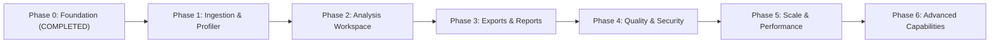

# Legacy generic EDA implementation roadmap

[Project Plan v3](EDAgent_Project_Plan_v3.pdf) ([source](EDAgent_Project_Plan_v3.tex)) governs the road-safety project. See the [environment setup guide](environment_setup.md) for the active application. The original generic EDA prototype roadmap is retained below as history; its phase numbers are distinct from the v3 road-safety phases.

## v3 transition and roadmap

V3 supersedes [v2](EDAgent_Project_Plan_v2.pdf) and treats the available evidence as the final project input. The diagnostic crosswalk accounted for 248,810 crash records but accepted zero primary site assignments. It did not establish reliable crash-to-road attribution, complete site-year observation, or validated traffic exposure. Station 375 remains internal diagnostic evidence: its observed 2023 crash count is unknown, and 11,072 vehicles/day is an archived 2023 traffic-section value for the section containing segment 0080, not validated site exposure.

Without a defensible expected crash count or validated treatment applicability for a real site, the release comprises reviewed v6 aggregates, diagnostic geography, review-only severity results, and a hypothetical intervention calculator. Site-level historical screening, frequency and Empirical Bayes modelling, and real-site treatment estimates are outside v3 release scope. Preserve publication safeguards and existing API contracts; use the canonical nested application and retain the general analyser.

- **Phases 0–2:** Carry forward the source and repository freeze, frozen v6 record and provenance, and fixed-input feasibility/no-go decisions.
- **Phase 3:** Reproduce diagnostic geography, conflict inventory, maps and QA; accept no primary site assignments.
- **Phase 4:** Review supported county/year and grid aggregates, denominators, coverage and severity limitations.
- **Phase 5:** Review treatment references and test hypothetical-only calculator arithmetic; real-site benefits remain unavailable.
- **Phase 6:** Deliver the aggregate Road Safety Overview first in the nested app, followed by bounded diagnostic, research and calculator views.
- **Phase 7:** Verify reproduction, traceability, accessibility, security, API compatibility and unknown/unavailable states before release.

## Historical generic EDA roadmap

This implementation plan is derived directly from Section 13 of the project blueprint. It structures the delivery of EDAgent into distinct, verifiable phases.

---

## Phase 0: Project Foundation (Current Phase — Done)
- **Deliverables**: Repository audit, architecture blueprint, folder structure, database schema, API contracts, baseline test suite with sample benchmark, environment documentation.
- **Exit Criteria**: All baseline tests pass (7/7 passed), data contracts and schemas aligned across frontend and backend.

---

## Phase 1: Upload & Automatic Profiler
- **Focus**: Ingesting structured tabular files and presenting the first-screen EDA overview.
- **Deliverables**:
  - Drag-and-drop file upload with progress bar, file size validation (max 100MB), and format validation (CSV, TSV, XLSX).
  - Excel sheet selector and detected sheet preview.
  - Ingestion preview displaying first 20 rows, last rows, random sample with horizontal/vertical scrolling.
  - Automatic baseline profiler:
    - Overview KPIs: rows, columns, memory footprint, load time.
    - Column inventory: inferred storage dtypes, semantic roles (`identifier`, `measure`, `category`, `datetime`, `boolean`, `text`).
    - Descriptive statistics: count, mean, std, min, quartiles, median, max, unique counts.
    - Missingness analysis: total missing cells, per-column missingness bar charts.
    - Duplicate detection: exact duplicate rows count vs. candidate duplicate keys.
    - Quality warnings: constant columns, near-constant columns, suspicious values, invalid dates.
- **Exit Criteria**: Profiling runs deterministically on agreed sample datasets without AI calls; test cases pass against datasets with known statistical properties.

---

## Phase 2: Analysis Workspace & AI Chat
- **Focus**: Interactive 3-part workspace and natural-language analysis.
- **Deliverables**:
  - Three-panel workspace layout:
    - Left: Schema drawer and analysis request history.
    - Center: Interactive Plotly chart canvas and data table.
    - Right/Bottom: Conversational AI analysis chat.
  - AI Orchestrator with structured function calling:
    - Translates user queries into machine-validated `StructuredAnalysisPlan` objects.
    - Column resolution and role checking against uploaded dataset schema.
    - Clarification dialog when queries are ambiguous.
    - Explicit fallback when a query cannot be answered from available columns.
  - Controlled Analysis Tool Catalogue execution:
    - Histogram with auto-binning and filter expressions.
    - Boxplot with IQR fences and category grouping.
    - Correlation matrix for suitable numeric measures.
    - Group-by aggregations (mean, median, sum, count) across categorical dimensions.
    - Outlier detection (1.5 * IQR rule).
- **Exit Criteria**: User can ask questions in plain English; AI plans calculations and backend executes them; results are rendered with interactive Plotly charts, code, and guardrailed explanations.

---

## Phase 3: Export Centre & One-Click EDA Report
- **Focus**: Reusable outputs and executive report compilation.
- **Deliverables**:
  - Per-analysis export options:
    - Download chart as PNG / SVG / interactive HTML.
    - Download result table as CSV / XLSX with formula sanitization.
    - Copy or download calculation code and parameters.
  - One-Click EDA Report Builder:
    - User section checklist: Executive summary, structure, quality, univariate, bivariate, user analyses, limitations, appendix.
    - PDF report generation (via ReportLab / WeasyPrint).
    - Clear visual separation between computed factual results and AI-generated narrative.
    - Reproducibility stamp (SHA-256 fingerprint, timestamp, software versions).
- **Exit Criteria**: Generated PDF report contains verified values, plots, and limitations; individual chart and CSV downloads pass verification.

---

## Phase 4: Quality, Security & Sandboxing
- **Focus**: Hardening execution boundaries, privacy, and abuse prevention.
- **Deliverables**:
  - Compute worker sandboxing with CPU and RAM quotas (2GB max, 300s timeout).
  - Production SSRF prevention for URL imports (blocking private IP ranges, cloud metadata endpoints, internal DNS).
  - Prompt-injection resistance validation in cell data.
  - CSV formula injection protection (`'`, `=`, `@`, `+`, `-`).
  - Session and dataset isolation tests (verifying User A cannot access User B's dataset).
- **Exit Criteria**: Security audit checklist passes; malicious files, archive bombs, and injection payloads fail safely.

---

## Phase 5: Scale, Performance & Background Jobs
- **Focus**: High-volume tabular analytics and asynchronous task queues.
- **Deliverables**:
  - Redis + Celery worker integration for long-running profiles and report compilation.
  - Real-time job status polling, progress bar, and user-initiated job cancellation.
  - DuckDB and Polars query engine integration:
    - Columnar Parquet conversion for repeated scans.
    - Filter pushdown and zero-copy aggregations for medium and large datasets (>50MB).
  - Storage provider abstraction linked to MinIO / AWS S3.
- **Exit Criteria**: Benchmarking demonstrates sub-second analytical queries on datasets up to 500,000 rows.

---

## Phase 6: Advanced Capabilities
- **Focus**: Statistical hypothesis testing, clustering, and external connectors.
- **Deliverables**:
  - Hypothesis testing module: Student's t-test, Mann-Whitney U, Chi-square test of independence with assumption validation.
  - Advanced exploratory algorithms: K-Means clustering, Principal Component Analysis (PCA) with 2D/3D Plotly projections.
  - Read-only user-authorized SQL database connectors.
- **Exit Criteria**: Advanced statistical methods validate sample sizes, distribution normality assumptions, and provide clear effect-size interpretations.
