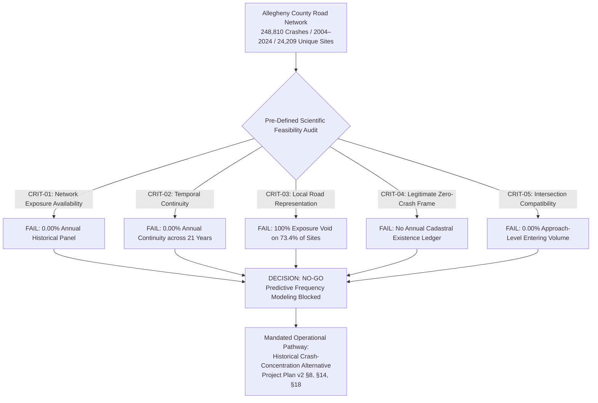

# Frequency Modelling Feasibility and Exposure Assessment

> **Superseded scope:** This report records earlier work and decisions. [Project Plan v3](../EDAgent_Project_Plan_v3.pdf) and the [v3 roadmap](../implementation_plan.md#v3-transition-and-roadmap) govern release scope: site-level historical screening, frequency/EB modelling and real-site treatment estimates are out of scope; geographic matches are diagnostic, with zero accepted primary assignments. Earlier claims of approval, mandatory pathways or pending release describe historical proposals, not current authorization.

**Project:** EDAgent — Road-Safety Analytics  
**Version:** 1.0.0  
**Phase:** Phase 4 — Module C (Documentation of Feasibility & Alternative Pathways)  
**Date:** November 2026  
**Status:** Authoritative Decision & Feasibility Document  

---

## 1. Executive Summary & Feasibility Decision

### Decision: **NO-GO**
**Predictive site-year crash-frequency modeling (Poisson regression, Negative Binomial regression, Safety Performance Functions [SPFs], and Empirical Bayes network screening) is STATISTICALLY AND OPERATIONALLY INFEASIBLE on the Allegheny County roadway network.**

In accordance with Project Plan v2 (§8, §18) and the core guidelines of the EDAgent project, statistical models requiring traffic exposure must not be fitted when adequate, verified exposure data does not exist. Substituting segment length or crash counts for traffic exposure is scientifically invalid and strictly prohibited.

---

## 2. Formal Evaluation of Feasibility Criteria

Prior to attempting model estimation, five scientific criteria were evaluated against the repository data. All five criteria failed decisively:

| Criterion ID | Criterion Name | Required Scientific Threshold | Repository Empirical Value | Status | Critical Implication |
|---|---|---|---|:---:|---|
| **CRIT-01** | Network-Wide Exposure Availability | $\ge 80.0\%$ of physical roadway sites have verified annual exposure | **0.00%** annual panel *(4.96% modern state snapshot)* | **FAIL** | Over 95% of the physical roadway network lacks traffic exposure. Models would lack the necessary exposure offset ($\text{AADT} \times L$). |
| **CRIT-02** | Temporal Exposure Continuity | $\ge 80.0\%$ of historical study years (2004–2024) have verified annual counts | **0.00%** annual panel *(Single cross-sectional snapshot only)* | **FAIL** | A single modern AADT snapshot cannot be backward-projected across 21 years of economic fluctuations and pandemic travel shifts without fabricating unsupported numbers. |
| **CRIT-03** | Road-Class Representation & Selection Bias | Representative coverage across all functional classes including local roads | **100.0% missing** on local municipal streets (73.41% of unique crash sites) | **FAIL** | Fitting a model exclusively on State Routes introduces severe selection bias, erasing municipal residential streets, pedestrian corridors, and local intersections. |
| **CRIT-04** | Legitimate Zero-Crash Observation Frame | Authoritative historical existence ledger for unmonitored road segments | **Single modern 2026 centerline snapshot**; zero annual historical existence records | **FAIL** | Assuming unmonitored roads existed continuously from 2004–2024 would manufacture synthetic zero-crash site-years in direct violation of project guidelines. |
| **CRIT-05** | Intersection Exposure Compatibility | Entering vehicle volumes for all intersection approaches | **0.00%** entering volume available on municipal and state intersections | **FAIL** | Intersection exposure cannot be approximated by segment length $\times$ AADT. Intersection frequency modelling is mathematically blocked. |

*Canonical decision matrix: `data/exports/traffic_exposure/feasibility_decision_matrix.csv`.*

---

## 3. Methodological and Mathematical Rationales

### 3.1 The Exposure Offset Requirement
In generalized linear models (GLMs) for count data, the expected annual crash frequency $\mu_{s,t}$ is parameterized with a logarithmic link function and a fixed exposure offset:

$$\ln(\mu_{s,t}) = x_{s,t}^T \beta + \ln(\text{Exposure}_{s,t})$$

where for road segments, vehicular exposure represents vehicle-miles traveled:
$$\text{Exposure}_{s,t} = \text{AADT}_{s,t} \times L_s \times 365 \times 10^{-6} \quad (\text{Million VMT})$$

If $\text{AADT}_{s,t}$ is omitted, the model estimates raw counts without controlling for traffic volume. Expressways carrying 80,000 vehicles/day would appear falsely high-risk, while hazardous municipal streets carrying 500 vehicles/day would appear falsely low-risk. This induces massive **omitted variable bias** ($\text{Cov}(x_j, \text{Exposure}) \neq 0$), biasing all structural coefficients $\beta$.

### 3.2 The Selection Bias Trap
Local municipal streets account for **73.41% of unique crash sites** (17,771 out of 24,209 unique sites) and 54,935 matched crashes. Because municipal traffic volume data is **0.00%**, fitting an exposure-adjusted model exclusively on State Routes creates severe **conditioning on jurisdiction (selection bias)**. The model would be legally and operationally useless for municipal Vision Zero programs, speed calming evaluations, and neighborhood pedestrian safety.

### 3.3 The Temporal Stationarity Fallacy
Even on the state route network where PennDOT publishes a modern cross-sectional snapshot (`CUR_AADT` in the 2024 RMSSEG layer), treating this single value as a historical annual panel (2004–2024) violates fundamental transportation principles:
- **The Great Recession (2008–2009):** Freight and commuter traffic contracted significantly.
- **The COVID-19 Pandemic (2020):** Vehicle travel collapsed by $20\%$ to $40\%$ statewide during lockdowns, followed by permanent hybrid telework shifts.
- Projecting a 2024 traffic volume backward across 21 years would distort crash rates and fabricate artificial temporal trends.

### 3.4 Zero-Crash Manufacturing Dilemma
Estimating an unbiased count model requires including un-crashed roadway segments ($Y_{s,t} = 0$). In Allegheny County, the road centerline layer is a single modern snapshot (2026 vintage). There is no annual cadastral ledger recording the exact year residential subdivision streets were dedicated, constructed, or opened to traffic between 2004 and 2024. Inferring continuous existence manufactures synthetic zero-crash site-years, while dropping them introduces truncation bias from below ($Y_{s,t} \ge 1$).

---

## 4. The Mandated Operational Pathway

Because predictive frequency modeling is blocked, the EDAgent platform formally deploys the **Historical Crash-Concentration Alternative** (§8, §14, §18 of Project Plan v2).

This pathway delivers actionable, defensible intelligence through:
1. **Empirical Spatial Density:** Crashes normalized by verified physical segment length ($\text{crashes/km}$, $\text{KSI/km}$, $\text{VRU/km}$).
2. **Multi-Epoch Temporal Persistence:** Categorizing sites across three 7-year historical epochs (2004–2010, 2011–2017, 2018–2024) to isolate persistent structural hazards from transient random noise.
3. **Within-Class Percentile Benchmarking:** Benchmarking local streets exclusively against local streets, and state routes against state routes.
4. **Geographical Coordinate Grounding:** Attaching validated coordinates to every high-concentration site for mapping and infrastructure planning.
