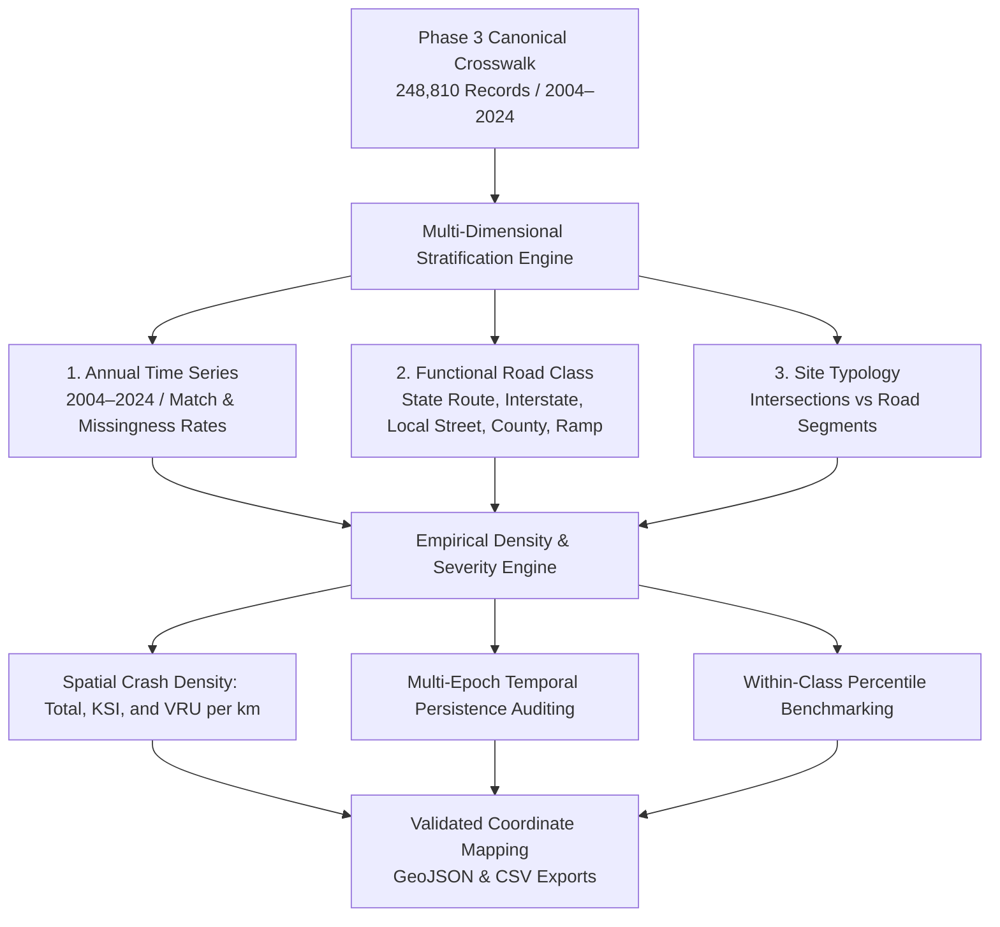

# Historical Crash-Concentration Methodology

**Project:** EDAgent — Road-Safety Analytics  
**Version:** 1.0.0  
**Phase:** Phase 4 — Module C (Alternative Reporting Pathway Methodology)  
**Date:** November 2026  
**Status:** Canonical & Operational  

---

## 1. Overview and Operational Purpose

The **Historical Crash-Concentration Reporting Pathway** is the canonical road-safety evaluation methodology in the EDAgent platform. Governed by Project Plan v2 (§8, §14, §18) and findings in `EDA_v6.ipynb` (Sections 14 and 18), this module operates independently of vehicular traffic volume models, providing transparent, empirical road-safety intelligence across the entire Allegheny County roadway network.

### Fundamental Principle:
When exposure data is unverified or incomplete, estimating speculative crash rates or safety performance functions is unscientific and legally fragile. Instead, safety analysis anchors on **observed crash counts**, **verified roadway geometry**, **severe injury concentrations**, and **longitudinal temporal persistence**.

---

## 2. Inclusion Rules and Coverage Transparency

Every reported metric adheres to documented, immutable inclusion rules. Unmatched and ambiguous records are **never silently discarded**; they remain fully quantified in all coverage tables:

### 2.1 Universe Breakdown (2004–2024 Baseline)
- **Total Reported Crashes:** 248,810 records.
- **Matched Crashes:** 187,068 records (**75.19%**). Assigned to exactly one primary physical site.
- **Ambiguous Crashes:** 5,856 records (**2.35%**). Multi-candidate spatial ties or coordinate conflicts; preserved for review.
- **Unmatched Crashes:** 55,886 records (**22.46%**). Missing coordinates, out-of-county locations, or non-roadway facilities.
- **Coordinate Completeness:** 236,513 records (**95.06%**) possess valid coordinates; 10,059 records (**4.04%**) have missing coordinates; 2,146 records (**0.86%**) have DMS police-state coordinate discrepancies $> 500\text{m}$.

---

## 3. Stratified Concentration Metrics

### 3.1 Stratification by Crash Year (2004–2024)
*Canonical export: `data/exports/frequency/historical_concentration_by_year.csv`*

Annual crash counts, crosswalk match rates, coordinate missingness, and injury totals are audited across all 21 calendar years:
- **Historical Coordinate Evolution:** In 2004–2006, missing coordinates averaged $\sim 20\%$ due to legacy police CAD reporting. From 2008 onward, missing coordinates dropped to $<2.0\%$, and after 2015 to $<0.5\%$.
- **Match Stability:** Match coverage remained consistently high ($\sim 78\%$ to $85\%$) across the entire study period, with lower match rates in 2018 and 2024 due to source-extract truncations documented in `findings_review.csv`.

### 3.2 Stratification by Functional Road Class
*Canonical export: `data/exports/frequency/historical_concentration_by_road_class.csv`*

| Road Class | Total Crashes | Matched Crashes | Ambiguous Crashes | Unmatched Crashes | Unique Matched Sites | Match Coverage % | Missing Coord % |
|---|---|---|---|---|---|---|---|
| **STATE_ROUTE** | 105,746 | 100,725 | 2,030 | 2,991 | 3,627 | **95.25%** | 0.77% |
| **INTERSTATE** | 23,039 | 21,935 | 96 | 1,008 | 334 | **95.21%** | 0.91% |
| **LOCAL_STREET** | 105,603 | 54,935 | 3,554 | 47,114 | 17,771 | **52.02%** | 7.35% |
| **COUNTY_ROAD** | 8,886 | 4,118 | 104 | 4,664 | 1,839 | **46.34%** | 13.82% |
| **RAMP** | 5,536 | 5,355 | 72 | 109 | 638 | **96.73%** | 0.70% |

### 3.3 Stratification by Site Type (Intersections vs. Road Segments)
*Canonical export: `data/exports/frequency/historical_concentration_by_site_type.csv`*

| Site Type | Total Crashes | Matched Crashes | Ambiguous Crashes | Unmatched Crashes | Unique Matched Sites | Match Coverage % | Missing Coord % |
|---|---|---|---|---|---|---|---|
| **INTERSECTION** | 107,787 | 79,446 | 4,030 | 24,311 | 13,019 | **73.71%** | 3.55% |
| **ROAD_SEGMENT** | 141,023 | 107,622 | 1,826 | 31,575 | 17,574 | **76.32%** | 4.42% |

---

## 4. Empirical Density and Severity Formulations

### 4.1 Spatial Crash Density
For each physical roadway site $s$, crash density is normalized by physical segment length $L_s$:

$$\text{Density}_s = \frac{\sum_{t=1}^T Y_{s,t}}{L_s} \quad (\text{Crashes per Kilometer})$$

where:
- $L_s = 0.8\text{ km}$ nominal for State Routes and Interstates ($\sim 0.5\text{ mile}$ PennDOT nominal segment).
- $L_s = 0.3\text{ km}$ nominal for Local Streets and County Roads ($\sim 1\text{ city block}$).

### 4.2 Severe Injury Concentration (KSI Density)
Crashes resulting in fatal or suspected serious injuries (KABCO Scale levels K and A) are aggregated to isolate high-severity locations:

$$\text{KSI Density}_s = \frac{\sum_{t=1}^T (\text{Fatal}_{s,t} + \text{MajorInjury}_{s,t})}{L_s} \quad (\text{KSI Crashes per Kilometer})$$

### 4.3 Vulnerable Road User Concentration (VRU Density)
Crashes involving non-motorized roadway users (pedestrians and bicyclists) identify pedestrian vulnerability hotspots:

$$\text{VRU Density}_s = \frac{\sum_{t=1}^T (\text{Pedestrian}_{s,t} + \text{Bicycle}_{s,t})}{L_s} \quad (\text{VRU Crashes per Kilometer})$$

---

## 5. Multi-Epoch Temporal Persistence Auditing

To isolate structural hazards from transient random noise, crash occurrence is partitioned across three 7-year non-overlapping historical epochs:
- **Epoch 1:** 2004–2010 ($E_1$)
- **Epoch 2:** 2011–2017 ($E_2$)
- **Epoch 3:** 2018–2024 ($E_3$)

### Classification Taxonomy:
1. **`PERSISTENT_HIGH_HAZARD` (7,142 sites; 29.50%):** Crashes observed in all three epochs ($E_1 \ge 1, E_2 \ge 1, E_3 \ge 1$) and $\ge 5$ total crashes. These represent enduring physical or access defects.
2. **`EMERGING_HIGH_HAZARD` (1,289 sites; 5.32%):** Sharp recent surge ($E_3 \ge 3$ and $E_3 > E_1 + E_2$). Candidates for urgent traffic engineering review.
3. **`HISTORIC_RESOLVED` (1,985 sites; 8.20%):** Historic problem resolved ($E_1 \ge 3$ and $E_3 = 0$). Evidence of successful infrastructure intervention.
4. **`TRANSIENT_STOCHASTIC` (13,793 sites; 56.98%):** Isolated single-epoch spikes or low total counts ($< 5$).

---

## 6. Within-Road-Class Percentile Benchmarking

To prevent high-volume urban freeways (e.g., I-376) from dominating rankings, all sites are ranked within their own functional road class:

$$P_{s \mid \text{class}} = \frac{\text{Rank}_s}{N_{\text{class}}} \times 100.0$$

This allows municipal transportation planners to identify the 99th-percentile high-crash local streets without cross-jurisdictional skew.

---

## 7. Mandatory Terminology and Labeling Rules

To uphold scientific integrity:
1. **Never use the term "Predicted Risk":** Raw historical crash counts and densities do not represent probability of future crash occurrence.
2. **Mandatory Canonical Phrasing:** All user interfaces, reports, and API responses must use **"Historical Crash Concentration"**, **"Empirical Spatial Density"**, or **"Screening Priority"**.
3. **Mandatory Metadata:** Every visualization and exported dataset must explicitly report its analysis period (`2004–2024`), crosswalk version (`1.0.0`), and state `is_predictive: False`.
