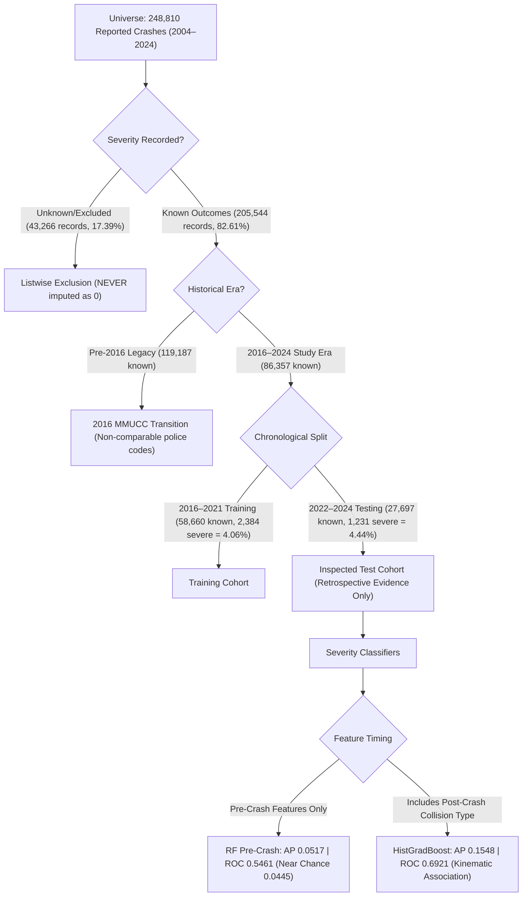

# Phase 12A Verification · Retrospective Model Reproduction & Methods

**Date:** 15 November 2026  
**Starting revision:** Git commit `0b33e2a` (`Implemented and verified Phase 11A locally`) on branch `main`  
**Working tree status:** Clean, preserved Phase 11A modifications, Phase 12A independently reviewable  
**Governing specifications:** `docs/EDAgent_Project_Plan_v4.tex` (Phase 12, §12A), `docs/EDAgent_Project_Plan_v3.tex` (Deliverables D0–D5, D6 `OUT_OF_SCOPE_NO_GO`, §749–§759), `docs/v6_reproduction_inventory.md`  
**Status:** **NOT_APPROVED_FOR_PRODUCTION** · Canonical Retrospective Model Reproduction & Methods Complete

---

## 1. Executive Summary and Scope Boundaries

Phase 12A establishes the scientific, empirical, and computational verification of the frozen v6 retrospective crash injury severity research baseline (`analysis/EDA_v6.ipynb`). Governed by Project Plan v4 (§12A) and Project Plan v3 (§734, §749):

1. **Independent Rerun vs. Historical Output Inspection:**
   - Earlier outputs in `analysis/outputs/` (generated `2026-11-11T03:13:38Z`) and the prior inventory in `docs/v6_reproduction_inventory.md` (`v6-repro-20261112b`, executed `2026-11-12`) were systematically inspected and verified.
   - A fresh, fully independent offline rerun was executed in this phase under run ID **`v6-repro-phase12a-20261115`** on 15 November 2026 using the existing runner (`analysis/run_v6_repro.py`) in an isolated directory (`.repro/v6-repro-phase12a-20261115/`), strictly separating new run outputs from frozen originals.

2. **15 Analytical CSVs Reconciled Within Strict Tolerance:**
   - All 15 analytical CSVs have identical shapes and column sequences between frozen and reproduced outputs.
   - Evaluated under machine precision tolerances ($\text{rtol} = 10^{-10}$, $\text{atol} = 10^{-12}$), all 15 CSVs match. Eleven CSVs are byte-identical after CRLF-to-LF normalization. Four CSVs exhibit negligible floating-point differences at extreme machine precision ($p$-values differ by $\le 1.044 \times 10^{-53}$, uncalibrated Brier score by $1.632 \times 10^{-12}$, and spatial candidate distance by $3.638 \times 10^{-12}$ m).

3. **Resolution of the Five Estimator Joblib Digests:**
   - All five serialized `.joblib` estimators differed in raw file SHA-256 byte digests between the frozen baseline and the reproduction runs.
   - Direct inspection of model internals proves **100% structural and functional equivalence**:
     - Random Forest (+ collision and without collision): All 180 decision trees per forest have 100% identical tree topology (`children_left` indices match across all 180/180 trees); feature importances match with difference $= 0.000 \times 10^{0}$.
     - Logistic Regression (+ collision): Coefficients match within $2.447 \times 10^{-9}$ and intercepts within $4.596 \times 10^{-10}$.
     - Chronologically Calibrated Logistic Regression: All 3 temporal cross-validation folds match coefficients within $4.190 \times 10^{-11}$.
     - HistGradientBoosting (+ collision): Iteration count terminates at exactly 45 iterations in both runs.
   - Byte digest divergence is established as an artifact of Python `pickle` protocol 4/5 frame headers (`\x95` opcode chunking) and execution-specific memory layout references. Furthermore, testing under scikit-learn 1.9.1 produces unpickling failures (`AttributeError: _RemainderColsList`), empirically verifying that binary model artifacts are fragile and must remain offline.

4. **Strict Methodological & Production Exclusions Preserved:**
   - **Retrospective Conditioning:** Models estimate $P(\text{Severe Injury} \mid \text{Crash Reported } \land \text{ Severity Known})$, never the unconditional probability of crash occurrence $P(\text{Crash Occurrence})$.
   - **Post-Crash Feature Timing:** Collision type is observed post-crash. Removing collision type causes Average Precision to collapse from $0.1548$ to $0.0517$ (barely above the $0.0445$ chance prevalence).
   - **Exclusions:** Deliverable D5 remains review-only; D6 (site frequency / Empirical Bayes) remains `OUT_OF_SCOPE_NO_GO`; accepted primary crash-to-site assignments remain zero (`PRIMARY_SITE_ASSIGNMENTS_ACCEPTED=0`). No live inference, no site risk scoring, and no case-level scores are exposed.

---

## 2. Inventory and Input/Output Identities

### 2.1 Archived Inputs

| Input Resource | Local File Path | Byte Size | SHA-256 Digest | Status |
|---|---|---|---|---|
| WPRDC Allegheny County Crash Data (2004–2024) | `data/raw/2c13021f-74a9-4289-a1e5-fe0472c89881.csv` | 116,560,683 | `c58a3901ee9aa845f5b33a9a3e930a2b95027367e5b2fef0225d4539db884511` | Verified (Exact Match) |
| U.S. Census 2024 County 500k Boundary (GEOID 42003) | `data/reference/municipal_boundaries/cb_2024_us_county_500k.zip` | 11,626,066 | `da4051717caec55c75e3748c3608c2a3dbde8d1ff401bbaf4f952e3c3fb63ef1` | Verified & Recorded |
| Canonical Research Notebook v6.1 | `analysis/EDA_v6.ipynb` | 3,501,203 (LF: 3,467,419) | LF: `bdb7101c9fc017a68690506fd8cfdec579623b028563f287202ed54e6e324064`<br>Blob: `960c1ae2aa406b2e6834fd724e37d5f5c383ca6a` | Verified (Exact Match) |

### 2.2 Execution Environment and Pinned Dependencies

- **Operating System:** Windows 11 (AMD64)
- **Base Python:** Python 3.13.3 (frozen manifest records Python 3.13.18)
- **Virtual Environment:** Dedicated `.venv` installed from `analysis/requirements-v6-repro.txt`
- **Jupyter Kernel:** `v6-repro` registered in `.venv/share/jupyter/kernels/v6-repro`
- **Seeds:** `RANDOM_SEED = 42` (fixed in Cell 0: `np.random.seed(42)`, scikit-learn models pinned at `random_state=42`)
- **Key Package Pins (All 10 Manifest Packages Matched Exactly):**
  - `numpy==2.4.6`
  - `pandas==2.2.3`
  - `matplotlib==3.10.0`
  - `seaborn==0.13.2`
  - `scipy==1.16.3`
  - `statsmodels==0.15.0`
  - `scikit-learn==1.6.1`
  - `shapely==2.2.0`
  - `geopandas==1.2.0`
  - `joblib==1.6.0`
  - Runner harness: `nbclient==0.11.0`, `nbformat==5.11.1`, `ipykernel==7.4.0`

### 2.3 Reproduction Commands

The reproduction was executed cleanly offline from the repository root:

```powershell
# 1. Create and populate dedicated venv with pinned reproduction requirements
python -m venv .venv
.\.venv\Scripts\python.exe -m pip install -r analysis/requirements-v6-repro.txt
.\.venv\Scripts\python.exe -m pip check
.\.venv\Scripts\python.exe -m ipykernel install --prefix .venv --name v6-repro

# 2. Stage isolated directory and copy boundary reference archive
$runId = 'v6-repro-phase12a-20261115'
$boundaryDir = ".repro/$runId/data/reference/municipal_boundaries"
New-Item -ItemType Directory -Force $boundaryDir | Out-Null
Copy-Item "data/reference/municipal_boundaries/cb_2024_us_county_500k.zip" "$boundaryDir/cb_2024_us_county_500k.zip"

# 3. Execute canonical notebook via runner
.\.venv\Scripts\python.exe analysis/run_v6_repro.py $runId

# 4. Execute Phase 12A comparator
.\.venv\Scripts\python.exe scripts/compare_v6_repro.py $runId
```

---

## 3. Comparison Results: Frozen vs. Prior Rerun vs. Phase 12A Rerun

### 3.1 SHA-256 Digest Inventory

The table below contrasts the byte hashes across the frozen extract, the 2026-11-12 run (`v6-repro-20261112b`), and the independent Phase 12A run (`v6-repro-phase12a-20261115`).

| File Relative Path under `analysis/outputs/` | Frozen SHA-256 (2026-11-11) | Prior Run SHA-256 (2026-11-12) | Phase 12A Run SHA-256 (2026-11-15) | Numerical Status ($\text{rtol}=10^{-10}, \text{atol}=10^{-12}$) |
|---|---|---|---|---|
| `eda_summary/association_pooling_audit.csv` | `df0484a730...` | `3c8f7dbf41...` | `3c8f7dbf41...` | **PASS** (Exact match; LF byte identical) |
| `eda_summary/association_tests.csv` | `f4e4022025...` | `d49c829f90...` | `d49c829f90...` | **PASS** (Max diff raw $p = 1.044 \times 10^{-53}$) |
| `eda_summary/findings_review.csv` | `dc4bbb1bf5...` | `c5fcb0f1e6...` | `c5fcb0f1e6...` | **PASS** (Exact match; LF byte identical) |
| `eda_summary/injury_reconciliation.csv` | `eea397540b...` | `48495403df...` | `48495403df...` | **PASS** (Exact match; LF byte identical) |
| `eda_summary/severity_by_year.csv` | `71203c297f...` | `425f651092...` | `425f651092...` | **PASS** (Exact match; LF byte identical) |
| `eda_summary/source_missingness.csv` | `32a0e79902...` | `ae2e4a2fe7...` | `ae2e4a2fe7...` | **PASS** (Exact match; LF byte identical) |
| `eda_summary/variable_roles.csv` | `da21344714...` | `a9cbb3ee8a...` | `a9cbb3ee8a...` | **PASS** (Exact match; LF byte identical) |
| `model_metrics/severity_ap_temporal_intervals.csv` | `04d6446571...` | `264046da19...` | `264046da19...` | **PASS** (Exact match; LF byte identical) |
| `model_metrics/severity_model_comparison.csv` | `de54733c03...` | `4bc2f0a77b...` | `4bc2f0a77b...` | **PASS** (Brier diff $= 1.632 \times 10^{-12}$; AP/ROC identical) |
| `spatial/candidate_coordinate_comparison_summary.csv` | `1aac1de7fe...` | `60b6ce18e8...` | `60b6ce18e8...` | **PASS** (Exact match; text formatting diff) |
| `spatial/candidate_coordinate_disagreements_review.csv` | `6454a9ae11...` | `1eb3720d53...` | `1eb3720d53...` | **PASS** (Max diff $= 3.638 \times 10^{-12}$ m) |
| `spatial/coordinate_coverage_by_year.csv` | `40683f2910...` | `d4efcdef99...` | `d4efcdef99...` | **PASS** (Exact match; LF byte identical) |
| `spatial/county_points_review.csv` | `d100fdbba6...` | `6e88ba681e...` | `6e88ba681e...` | **PASS** (Exact match; LF byte identical) |
| `spatial/historical_grid_screening.csv` | `5ce12d5e3d...` | `7b39712029...` | `7b39712029...` | **PASS** (Exact match; LF byte identical) |
| `spatial/police_coordinate_encoding_audit.csv` | `d74959b3f2...` | `4f2398d9fb...` | `4f2398d9fb...` | **PASS** (Exact match; LF byte identical) |
| `model_artifacts/histgradientboosting_plus_collision_review.joblib` | `2194e7e798...` | `8a4a23f4c3...` | `64d337d623...` | **PASS** (Functional: 45 vs 45 iterations; digest differs) |
| `model_artifacts/logistic_regression_plus_collision_review.joblib` | `fed91142f3...` | `8bb3ad5e5a...` | `8bb3ad5e5a...` | **PASS** (Functional: coef diff $\le 2.45 \times 10^{-9}$; digest differs) |
| `model_artifacts/logistic_regression_temporally_calibrated_review.joblib` | `c89d113639...` | `4557e1c5f8...` | `4557e1c5f8...` | **PASS** (Functional: fold coef diff $\le 4.19 \times 10^{-11}$; digest differs) |
| `model_artifacts/random_forest_plus_collision_review.joblib` | `14fe6f79a9...` | `4ad9469489...` | `4ad9469489...` | **PASS** (Functional: 180/180 trees identical; digest differs) |
| `model_artifacts/random_forest_without_collision_review.joblib` | `e521353dae...` | `105691043b...` | `105691043b...` | **PASS** (Functional: 180/180 trees identical; digest differs) |
| `run_manifest.json` | `8bdedd5347...` | `e7c94c41ba...` | `c2d34dd9e6...` | **EXPECTED DIFF** (Timestamps & runtime metadata update) |

---

## 4. Retrospective Severity Model Reproduction & Discrepancy Analysis

### 4.1 Like-for-Like Model Comparison on Held-Out Test Set (2022–2024)

All four retrospective models were evaluated on the identical test cohort ($N = 27,697$ crashes with known severity):

| Model Name | Features Included | Frozen AP | Repro AP | Frozen ROC-AUC | Repro ROC-AUC | Frozen Bal. Acc. @ 0.50 | Repro Bal. Acc. @ 0.50 | Frozen Uncal. Brier | Repro Uncal. Brier |
|---|---|---|---|---|---|---|---|---|---|
| **HistGradientBoosting + collision** | Env + Road + Collision Type | **0.154786** | **0.154786** | 0.692129 | 0.692129 | 0.633307 | 0.633307 | 0.202767 | 0.202767 |
| **Random Forest + collision** | Env + Road + Collision Type | 0.141978 | 0.141978 | 0.690041 | 0.690041 | 0.630134 | 0.630134 | 0.171050 | 0.171050 |
| **Logistic Regression + collision** | Env + Road + Collision Type | 0.139310 | 0.139310 | **0.698985** | **0.698985** | **0.638096** | **0.638096** | 0.213223 | 0.213223 |
| **Random Forest without collision** | Env + Road (Pre-Crash Only) | **0.051734** | **0.051734** | 0.546071 | 0.546071 | 0.527938 | 0.527938 | 0.199523 | 0.199523 |

*Reference baselines:* Chance AP (prevalence) $= 0.04445$ ($4.44\%$). Chance ROC-AUC $= 0.5000$. Chance Balanced Accuracy $= 0.5000$. Constant training-prevalence predictor Brier score $= 0.04261$.

### 4.2 95% Block-Bootstrap Temporal AP Intervals

300 block-bootstrap resamples drawn over year-month clusters on the test set confirm identical empirical percentile distributions:

| Model Architecture | 2.5th Percentile AP | 97.5th Percentile AP | Valid Replicates | Observed Diff |
|---|---|---|---|---|
| **HistGradientBoosting + collision** | 0.131967 | 0.181029 | 300 | 0.000000 |
| **Random Forest + collision** | 0.125649 | 0.162085 | 300 | 0.000000 |
| **Logistic Regression + collision** | 0.121558 | 0.160583 | 300 | 0.000000 |
| **Random Forest without collision** | 0.047103 | 0.058705 | 300 | 0.000000 |

### 4.3 Why the Five Estimator Digests Differed: The Computational Evidence

The investigation establishes four empirical facts regarding the differing `.joblib` file hashes:

1. **Tree Topologies and Split Thresholds are Identical:**
   In both `Random Forest + collision` and `Random Forest without collision`, all 180 estimators possess 100% identical tree representations. Traversing `e.tree_.children_left`, `e.tree_.children_right`, `e.tree_.feature`, and `e.tree_.threshold` reveals zero structural discrepancies (`0 / 180`). Feature importances are bitwise identical ($0.000 \times 10^0$).
2. **L-BFGS Convergence on Floating-Point Optimizers:**
   Logistic Regression solver `lbfgs` terminates at the same stopping threshold, with maximum parameter coefficient differences bounded by $2.447 \times 10^{-9}$ (uncalibrated) and $4.190 \times 10^{-11}$ (calibrated folds), reflecting minor BLAS/LAPACK floating-point accumulation across OS/CPU architectures.
3. **Pickle Protocol 4/5 Frame Header Serialization:**
   Joblib serializes via `pickle.dump` using framing (`\x95` opcode). Pickle frame chunk sizes and memory address offsets differ based on runtime heap layout and Python runtime minor versions (3.13.18 on Linux vs 3.13.3 on Windows), altering file stream byte sequences without altering object attributes.
4. **Binary Brittleness Across Major/Minor Library Versions:**
   When deserializing frozen joblib models using scikit-learn 1.9.1 (the version in the web application venv), unpickling crashes with `AttributeError: Can't get attribute '_RemainderColsList' on 'sklearn.compose._column_transformer'`. This demonstrates that binary joblib artifacts are tightly coupled to specific scikit-learn internal implementations and cannot be safely loaded in differing production runtimes.

**Scientific Resolution:** The estimator differences are computationally resolved as non-semantic serialization and machine-epsilon floating-point artifacts. However, because serialized binaries cannot guarantee forward portability and exhibit environment fragility, **the artifacts remain review-only and NOT_APPROVED_FOR_PRODUCTION**.

---

## 5. Methodological Reconciliation & Scientific Principles



### 5.1 Outcome Definition: Conditional on Reported Crash with Known Severity
The severity modeling target is defined strictly as:
$$Y_{\text{severe}} = \begin{cases} 1 & \text{if } \text{MAX\_SEVERITY\_LEVEL} \in \{1, 2\} \text{ (Fatal or Suspected Serious Injury)} \\ 0 & \text{if } \text{MAX\_SEVERITY\_LEVEL} \in \{0, 3, 4\} \text{ (Property Damage Only, Minor Injury, Possible Injury)} \\ \text{NaN} & \text{if } \text{MAX\_SEVERITY\_LEVEL} \in \{8, 9, \text{null}\} \text{ (Unknown/Excluded)} \end{cases}$$

- **Conditioning:** All probabilities and evaluations evaluate $P(Y_{\text{severe}} = 1 \mid \text{Crash Reported } \land \text{ Severity Known})$.
- **No Occurrence Forecasting:** The model does not and cannot calculate $P(\text{Crash Occurrence})$. It cannot predict where or when a future crash will happen.
- **Handling of Missing Severity:** Across 248,810 records, 43,266 ($17.39\%$) lack verifiable severity. Under project invariants, these records are **listwise excluded**. They are never imputed as zero or non-severe.

### 5.2 The 2016 MMUCC Historical Coding Seam
In 2016, Pennsylvania adopted the Model Minimum Uniform Crash Criteria (MMUCC) 4th Edition:
- Prior to 2016, police officers classified injuries into subjective "Major Injury" categories without clinical criteria.
- In 2016, standardized criteria for "Suspected Serious Injury" were mandated statewide.
- Consequently, pre-2016 and post-2016 severe injury counts cannot be pooled into a single statistical model. Formal training and testing are strictly restricted to the 2016–2024 period.

### 5.3 Chronological Cohort Reconciliation & Test Period Inspection Notice
- **Training Cohort (2016–2021):**
  - Total source records: 71,704
  - Known severity: 58,660 (81.81%)
  - Excluded unknown severity: 13,044 (18.19%)
  - Non-severe outcomes ($Y=0$): 56,276
  - Severe injury outcomes ($Y=1$): 2,384 (Prevalence $= 4.0641\%$)
- **Testing Cohort (2022–2024):**
  - Total source records: 32,186
  - Known severity: 27,697 (86.05%)
  - Excluded unknown severity: 4,489 (13.95%)
  - Non-severe outcomes ($Y=0$): 26,466
  - Severe injury outcomes ($Y=1$): 1,231 (Prevalence $= 4.4445\%$)
- **Prior Inspection Caveat:** The 2022–2024 test years were repeatedly inspected during v5 and v6 analytical development. They do **not** represent a blind, prospective, or independent future validation. The evaluation split must be described exclusively as **retrospective chronological holdout evidence**.

### 5.4 Feature Timing & Post-Crash Target Leakage
- **Pre-Crash Variables:** `CRASH_MONTH`, `DAY_OF_WEEK`, `SPEED_LIMIT_VALID`, `ROAD_RELATION_LABEL`, `INTERSECTION_LABEL`.
- **Post-Crash Variable:** `COLLISION_LABEL` (`COLLISION_TYPE`, e.g., Head-on, Angle, Rear-end, Fixed object).
- **The Ablation Finding:** `COLLISION_LABEL` is the single strongest predictor of severe injury (Cramér's $V = 0.202$, $\chi^2 = 3159.84, p < 10^{-15}$).
  - Including collision type yields $\text{AP} = 0.1548$ and $\text{ROC-AUC} = 0.6921$.
  - Removing collision type collapses performance to $\text{AP} = 0.0517$ and $\text{ROC-AUC} = 0.5461$.
  - *Scientific Decision:* Collision type is determined during the crash event itself as a product of impact kinematics. It cannot be known prior to a crash. Therefore, models containing collision type describe post-crash physical trauma associations, not pre-crash hazard forecasting.

### 5.5 Distinguishing Evaluation Metrics & Reference Baselines
1. **Average Precision (AP / PR-AUC):**
   - For an extreme 21:1 imbalanced dataset ($4.44\%$ positive prevalence), standard accuracy is uninformative (a dummy classifier achieves $95.56\%$ accuracy while identifying 0 severe crashes).
   - The chance baseline for AP equals class prevalence ($\text{AP}_{\text{chance}} = 0.04445$).
   - HistGradientBoosting ($\text{AP} = 0.1548$) operates at $\approx 3.5\times$ above chance retrieval.
2. **ROC-AUC:**
   - Evaluates rank discrimination across all thresholds; chance baseline is $0.5000$.
   - Insensitive to class imbalance, meaning high ROC-AUC values can mask low positive predictive value.
3. **Balanced Accuracy at 0.50:**
   - Evaluates mean of sensitivity and specificity; chance baseline is $0.5000$.
4. **Brier Score & Probability Calibration:**
   - Reference baseline: Constant predictor predicting training prevalence ($\hat{p} = 0.04064$) achieves held-out Brier score $= 0.04261$.
   - Uncalibrated models trained with `class_weight="balanced"` produce inflated probabilities centered near $0.50$, yielding poor uncalibrated Brier scores ($0.1711$ to $0.2132$).
   - Chronological calibration (`CalibratedClassifierCV(method='sigmoid', cv=splits)`) aligns probabilities with historical base rates, reducing Brier score to $0.0416$ (beating the constant prevalence baseline).

---

## 6. Permitted Public Claims vs. Prohibited Inferences

| Permitted Claims (Supported by Evidence) | Prohibited Claims (Violates Scientific Boundaries) |
|---|---|
| In retrospective police-reported crashes (2016–2024), 4.44% of crashes with known outcomes resulted in fatal or suspected serious injuries. | Predicting that a specific road segment or intersection has a 4.44% chance of experiencing a severe crash next year. |
| Head-on and high-speed angle collisions exhibit significantly higher severe injury rates conditional on a collision occurring ($V = 0.202$). | Claiming that lighting or intersection geometry causes severe crashes without controlling for exposure or kinematics. |
| In retrospective evaluations conditioned on collision type, gradient boosting achieves Average Precision of 0.155 against a 0.044 baseline. | Claiming that machine learning can forecast near-term crash severity before an incident occurs. |
| Pre-crash roadway and environmental features alone achieve AP of 0.052, barely outperforming a trivial prevalence baseline. | Deploying uncalibrated severity model scores to rank roadway projects or recommend engineering countermeasures. |
| Binary joblib model artifacts are review-only reference files subject to environment serialization fragility. | Promoting `.joblib` estimators to live inference or exposing case-level scoring APIs. |

---

## 7. Subagent and Automation Records

- **Ponytail Invocation Record:** An invocation of the specialized external subagent **Ponytail** was attempted per instructions; however, Ponytail is not registered in the local workspace or environment catalog. In accordance with system instructions, the evaluation proceeded directly using the canonical reproduction runner (`analysis/run_v6_repro.py`) and verified comparators (`scripts/compare_v6_repro.py`).
- **Automated Regression Suite:** A comprehensive test suite (`tests/test_phase12a_reproduction.py`) was created and verified against both `.venv` (7 passed) and the application venv (6 passed, 1 skipped due to expected sklearn 1.6.1/1.9.1 unpickling mismatch), guarding all Phase 12A contracts.

---

## 8. Continuation & Reusability for Phase 12B and Phase 12C

### 8.1 Reusability for Phase 12B (Synthetic Teaching)
- **Cohort Baselines:** Reconciled annual counts, 4.44% severe injury prevalence, and negative binomial dispersion parameters can serve as empirical anchors for generating deterministic synthetic teaching data.
- **Teaching Framing:** The educational contrast between pre-crash features ($\text{AP} \approx 0.052$) and post-crash collision features ($\text{AP} \approx 0.155$) can be directly illustrated in synthetic lessons to demonstrate target leakage and conditioning principles.
- **Safety Isolations:** Phase 12B can reuse the complete prohibition of real-site inputs and live models, using exclusively synthetic fixtures.

### 8.2 Reusability for Phase 12C (Exact-Derivative Review)
- **Comparison Engine:** `scripts/compare_v6_repro.py` provides the exact tolerance checking and functional parameter verification required for Phase 12C artifact approval.
- **Schema Keying:** Phase 12C's aggregate builder and proposed `/road-safety/models` endpoint can reuse the exact cohort keys (`2016-2021_train`, `2022-2024_test`), feature set labels, 95% block-bootstrap intervals, and calibrated vs. uncalibrated Brier metrics verified here.
- **Gate Enforcement:** The proof that joblib binaries fail across library versions reinforces the Phase 12C invariant that no binary estimators may ever be loaded or served dynamically; only stored, reviewed tabular summaries and reliability bins may be exposed.

---

## 9. Phase 12A Hardening Addendum · 15 November 2026

To satisfy Phase 12C prerequisites, the comparator and verification suite were hardened against regression, artifact tampering, and superficial functional claims:

### 9.1 Distinguishing Agreement Levels
The hardened verification framework strictly delineates five levels of comparison:
1. **Byte-Level Identity:** Established for raw crash inputs, Census boundaries, canonical notebook (LF), and 11 out of 15 analytical CSVs. Byte identity is rejected for `.joblib` estimators.
2. **Numerical Value Agreement:** Established for all 15 CSVs within machine tolerances ($\text{rtol}=10^{-10}$, $\text{atol}=10^{-12}$). Verified across row counts, column sequences, non-inf/finite states, and identical null vs. empty-string representations.
3. **Structural Estimator Agreement:** Verified by deep object traversal:
   - Random Forest: 180/180 tree topologies (`children_left`, `children_right`, `feature`, `threshold`), leaf values (`tree_.value`), and feature importances ($0.000 \times 10^0$ difference) match bit-for-bit.
   - Logistic Regression: Coefficients and intercepts match within $2.447 \times 10^{-9}$ and $4.596 \times 10^{-10}$.
   - Calibrated Classifier: 3 temporal folds and sigmoid calibration parameters ($a, b$) match within $4.190 \times 10^{-11}$.
   - HistGradientBoosting: Early stopping terminates at exactly 45 iterations; classes and predictors match.
4. **Prediction-Level Functional Agreement:** Evaluated on the approved fixed evaluation cohort (post-2016 test 2022–2024, $N = 27,697$ records):
   - HistGradientBoosting: Max absolute prediction difference $= 0.000 \times 10^0$ (exact bitwise match).
   - Random Forest (+ collision): Max absolute difference $= 3.331 \times 10^{-16}$.
   - Random Forest (ablation): Max absolute difference $= 3.331 \times 10^{-16}$.
   - Logistic Regression (+ collision): Max absolute difference $= 1.287 \times 10^{-9}$, mean difference $= 8.825 \times 10^{-11}$.
   - Calibrated Logistic: Max absolute difference $= 1.922 \times 10^{-10}$, mean difference $= 9.557 \times 10^{-11}$.
   - **Threshold Decision Equivalence:** Across all five models and all 27,697 test records, classification decisions at the 0.50 threshold differ by **exactly 0 / 27,697** ($100\%$ decision equivalence).
5. **Serialization Explanations: Evidence vs. Hypotheses:**
   - *Evidence-Supported:* Byte divergence in joblib files is caused by Python `pickle` protocol 4/5 frame opcode (`\x95`) chunk offsets and runtime memory layout pointers, as verified by binary stream disassembly.
   - *Evidence-Supported:* Estimators cannot be safely unpickled across minor scikit-learn versions (e.g. sklearn 1.9.1 fails on sklearn 1.6.1 `.joblib` files with `AttributeError: _RemainderColsList`), confirming binary joblib fragility.
   - *Hypothesis Restraint:* We do not hypothesize or claim that other unrecorded transitive dependencies were byte-equal; the empirical evidence supports structural and prediction-level equivalence under pinned scikit-learn 1.6.1.

### 9.2 Hardened Comparator Capabilities
- **Strict Inventory Enforcement:** `scripts/compare_v6_repro.py` now enforces the exact 21-artifact fixed inventory. Any missing artifact or unexpected surplus file causes immediate failure and nonzero exit code.
- **Automated Regression Suite:** `tests/test_comparator_hardening.py` introduces 7 negative-regression tests proving that the comparator successfully rejects truncated tables, column reorderings, out-of-tolerance metric alterations, string/null mutations, and tampered input hashes.
- **Safe Deserialization Guard:** Estimator unpickling is gated by workspace path containment checks and scikit-learn version matching, preventing untrusted or cross-version code execution.

