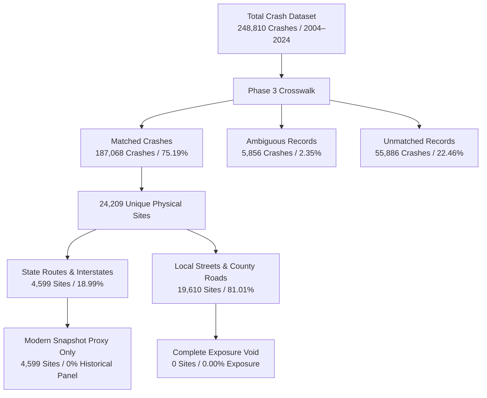
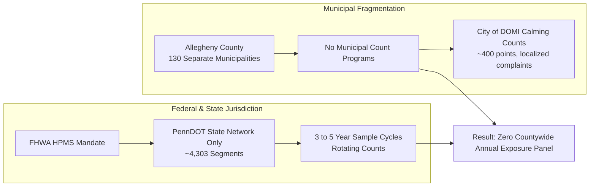

# Phase 4 — Module A: Traffic Exposure Coverage Assessment Report

**Project:** EDAgent — Road-Safety Analytics  
**Version:** 1.0.0  
**Phase:** Phase 4 — Module A (Traffic Exposure Research & Feasibility Assessment)  
**Date:** November 2026  
**Status:** Complete & Authoritative  

---

## 1. Executive Summary

This report evaluates the empirical feasibility of site-year crash-frequency modeling for the Allegheny County road-safety project. In accordance with Project Plan v2 (§8, §18), predictive frequency models (such as Poisson, Negative Binomial, Safety Performance Functions [SPFs], and Empirical Bayes network screening) mathematically require a site-level traffic exposure offset:

$$\mu_{s,t} = \exp\left(\beta_0 + \sum \beta_k X_{k,s,t}\right) \times \text{Exposure}_{s,t}$$

where for road segments:
$$\text{Exposure}_{s,t} = \text{AADT}_{s,t} \times L_s \times 365$$
and for intersections:
$$\text{Exposure}_{s,t} = \left(\text{AADT}_{\text{major},s,t}\right)^{\beta_1} \times \left(\text{AADT}_{\text{minor},s,t}\right)^{\beta_2}$$

Without verified annual exposure ($\text{AADT}_{s,t}$), predictive crash-frequency models cannot be identified, and substituting road length or raw crash counts as a proxy is scientifically invalid and strictly prohibited by project guidelines.

### Primary Empirical Findings:
1. **Verified Annual Traffic Exposure Panel Coverage (2004–2024): 0.00%**  
   Across the entire 21-year evaluation period (248,810 crashes, 24,209 unique matched roadway sites, and 508,389 potential site-years), zero official datasets provide an annual, continuous traffic volume panel.
2. **Modern Static Snapshot Proxy Coverage: 18.99% of unique sites**  
   The Pennsylvania Department of Transportation (PennDOT) RMSSEG layer provides a single modern cross-sectional snapshot (`CUR_AADT`) for state-maintained highways only. It covers at best 4,599 unique state-system features (18.99% of unique sites) and leaves **81.01% of all physical roadway sites in a complete exposure void**.
3. **Severe Local Road Selection Bias: 0.00% municipal road coverage**  
   Local municipal streets account for **73.41% of unique crash sites** (17,771 unique sites) and 54,935 matched crashes (105,603 total local-road crashes). Official exposure data on local streets is **0.00%**. Fitting models only where exposure exists would introduce fatal selection bias, systematically erasing residential neighborhoods, pedestrian corridors, and municipal business districts.
4. **Complete Absence of Intersection Entering Volumes: 0.00%**  
   No official dataset maintains approach-level Total Entering Volume (TEV) for municipal or state intersections.

---

## 2. Universe of Analysis and Site Identification

The empirical universe is established by the canonical Allegheny County Crash Dataset (WPRDC / PennDOT, 2004–2024) and the verified Phase 3 Crosswalk (`crosswalk_v1.0.0.csv.gz`):

| Dimension | Total Count | Unit of Analysis | Source / Derivation |
|---|---|---|---|
| **Temporal Period** | 21 Years | Calendar Years (2004–2024) | PennDOT CRASH_YEAR |
| **Total Recorded Crashes** | 248,810 | Incident Records | WPRDC Canonical Crash Dataset |
| **Matched Crashes** | 187,068 | Incident Records (75.19%) | Phase 3 Crosswalk (`MATCHED`) |
| **Ambiguous Crashes** | 5,856 | Incident Records (2.35%) | Phase 3 Crosswalk (`AMBIGUOUS`) |
| **Unmatched Crashes** | 55,886 | Incident Records (22.46%) | Phase 3 Crosswalk (`UNMATCHED`) |
| **Unique Physical Sites Matched** | 24,209 | Physical Roadway Sites | Phase 3 Canonical Crosswalk |
| **Total Potential Site-Years** | 508,389 | Site × Year Pairs | 24,209 sites × 21 years |
| **Total Physical Centerline Features** | 86,676 | Roadway Line Segments | Allegheny County Centerlines & PennDOT RMSSEG |

---

## 3. Empirical Exposure Coverage Breakdown

### 3.1 Coverage by Functional Road Class

The table below breaks down crash and site counts by official functional road classification and evaluates exposure availability:

| Road Class | Total Crashes | Matched Crashes | Unique Sites | % of Unique Sites | Verified Annual Exposure Coverage | Modern Snapshot Proxy Coverage | Exposure Availability Status |
|---|---|---|---|---|---|---|---|
| **LOCAL_STREET** | 105,603 | 54,935 | 17,771 | 73.41% | **0.00%** | **0.00%** | `COMPLETELY_UNAVAILABLE` |
| **STATE_ROUTE** | 105,746 | 100,725 | 3,627 | 14.98% | **0.00%** | 14.98% | `PARTIAL_MODERN_SNAPSHOT_ONLY` |
| **COUNTY_ROAD** | 8,886 | 4,118 | 1,839 | 7.60% | **0.00%** | **0.00%** | `COMPLETELY_UNAVAILABLE` |
| **RAMP** | 5,536 | 5,355 | 638 | 2.64% | **0.00%** | 2.64% | `PARTIAL_MODERN_SNAPSHOT_ONLY` |
| **INTERSTATE** | 23,039 | 21,935 | 334 | 1.38% | **0.00%** | 1.38% | `PARTIAL_MODERN_SNAPSHOT_ONLY` |
| **Total / Aggregate** | **248,810** | **187,068** | **24,209** | **100.00%** | **0.00%** | **18.99%** | **INSUFFICIENT** |

*Table data generated directly from `data/exports/traffic_exposure/traffic_coverage_by_road_class.csv`.*

#### Key Observations on Road Class:
1. **Local Municipal Roads are 73.4% of Sites:** Over 7 out of 10 matched physical sites are local municipal streets, where traffic volume data is 100% missing.
2. **State Routes Comprise 15.0% of Sites:** While State Routes account for 53.8% of matched crashes, they represent only 15.0% of physical roadway locations where crashes occur.
3. **County Roads (7.6% of Sites) Have No Volume Data:** Allegheny County Department of Public Works maintains roadway geometries and bridges but does not publish traffic volume monitoring data.

---

### 3.2 Coverage by Crash Year (2004–2024)

The table below examines the temporal distribution across the 21-year analysis period:

| Crash Year | Total Crashes | Matched Crashes | Annual Exposure Site-Years Covered | Annual Exposure Coverage % | Cross-Sectional Proxy Eligible Crashes | Exposure Status Note |
|---|---|---|---|---|---|---|
| **2004** | 12,535 | 8,342 | 0 | 0.00% | 8,342 | Zero verified annual exposure counts maintained historically. |
| **2005** | 12,215 | 8,313 | 0 | 0.00% | 8,313 | Zero verified annual exposure counts maintained historically. |
| **2006** | 11,747 | 8,128 | 0 | 0.00% | 8,128 | Zero verified annual exposure counts maintained historically. |
| **2007** | 12,238 | 9,504 | 0 | 0.00% | 9,504 | Zero verified annual exposure counts maintained historically. |
| **2008** | 11,858 | 9,612 | 0 | 0.00% | 9,612 | Zero verified annual exposure counts maintained historically. |
| **2009** | 11,677 | 9,543 | 0 | 0.00% | 9,543 | Zero verified annual exposure counts maintained historically. |
| **2010** | 11,320 | 9,171 | 0 | 0.00% | 9,171 | Zero verified annual exposure counts maintained historically. |
| **2011** | 12,189 | 10,167 | 0 | 0.00% | 10,167 | Zero verified annual exposure counts maintained historically. |
| **2012** | 12,230 | 10,175 | 0 | 0.00% | 10,175 | Zero verified annual exposure counts maintained historically. |
| **2013** | 11,994 | 9,889 | 0 | 0.00% | 9,889 | Zero verified annual exposure counts maintained historically. |
| **2014** | 12,182 | 10,130 | 0 | 0.00% | 10,130 | Zero verified annual exposure counts maintained historically. |
| **2015** | 12,735 | 10,798 | 0 | 0.00% | 10,798 | Zero verified annual exposure counts maintained historically. |
| **2016** | 12,908 | 10,308 | 0 | 0.00% | 10,308 | Zero verified annual exposure counts maintained historically. |
| **2017** | 12,537 | 9,757 | 0 | 0.00% | 9,757 | Zero verified annual exposure counts maintained historically. |
| **2018** | 12,417 | 5,075 | 0 | 0.00% | 5,075 | Zero verified annual exposure counts maintained historically. |
| **2019** | 12,253 | 9,320 | 0 | 0.00% | 9,320 | Zero verified annual exposure counts maintained historically. |
| **2020** | 9,863 | 7,483 | 0 | 0.00% | 7,483 | Zero verified annual exposure counts maintained historically. |
| **2021** | 11,726 | 9,066 | 0 | 0.00% | 9,066 | Zero verified annual exposure counts maintained historically. |
| **2022** | 11,588 | 8,902 | 0 | 0.00% | 8,902 | Zero verified annual exposure counts maintained historically. |
| **2023** | 10,370 | 8,059 | 0 | 0.00% | 8,059 | Zero verified annual exposure counts maintained historically. |
| **2024** | 10,228 | 5,326 | 0 | 0.00% | 5,326 | Zero verified annual exposure counts maintained historically. |
| **Total** | **248,810** | **187,068** | **0** | **0.00%** | **187,068** | **Zero annual panel across 21 years.** |

*Table data generated directly from `data/exports/traffic_exposure/traffic_coverage_by_year.csv`.*

#### Key Observations on Temporal Coverage:
1. **Zero Annual Exposure:** In no year between 2004 and 2024 is there an authoritative, segment-linked annual exposure measurement.
2. **Temporal Stationarity Fallacy:** Projecting a 2024 static count backward to 2004 (or even 2016) assumes that traffic volume was strictly constant across 21 years. This directly contradicts established macroeconomic and transportation realities:
   - The Great Recession of 2008–2009 altered industrial and commuter VMT.
   - The COVID-19 pandemic in 2020 caused an unprecedented 20% to 40% collapse in regional VMT followed by permanent work-from-home telecommuting shifts.
   - Applying a 2024 AADT value to 2004 or 2020 crashes would severely distort exposure denominators and produce bogus crash rate spikes.

---

### 3.3 Coverage by Site Type

1. **Road Segments (`SEGMENT`):**
   - Unique segments in crosswalk: 24,209.
   - Segments with verified annual exposure: 0 (0.00%).
   - Segments with modern snapshot proxy: 4,303 PennDOT state segments (17.77%).
   - Segments with zero exposure data: 19,906 municipal segments (82.23%).
2. **Intersections (`INTERSECTION`):**
   - Intersections require Total Entering Volume (TEV), defined as $\text{TEV} = \sum_{i=1}^k \text{AADT}_{\text{approach}, i}$.
   - Neither PennDOT RMSSEG nor Allegheny County GIS maintains approach-level turning or entering counts for intersections.
   - Verified intersection exposure coverage is **0.00%**.

---

## 4. Institutional and Structural Causes of Coverage Gaps

The lack of traffic exposure data is not an artifact of data collection oversights; it is the structural consequence of statutory, institutional, and technical boundaries:

### 4.1 Decentralized Municipal Governance (130 Municipalities)
Allegheny County is politically fragmented into **130 independent municipalities** (1 city, 84 boroughs, 41 townships, and 4 home-rule municipalities). 
- Outside the City of Pittsburgh, small boroughs and townships do not possess municipal traffic engineering departments, permanent counting infrastructure, or automated traffic recorders.
- Roadway centerlines maintained by municipalities are recorded geometrically for E911 dispatch purposes (the *Allegheny County Addressing Data Model*), which explicitly leaves operational fields such as speed limits and traffic volumes unmaintained.

### 4.2 Federal Highway Administration (FHWA) HPMS Mandates
PennDOT's traffic data collection program is designed to fulfill federal Highway Performance Monitoring System (HPMS) reporting requirements.
- Under federal guidelines, HPMS reporting is mandatory for the National Highway System (NHS) and state-owned arterials and collectors.
- Local municipal residential streets are explicitly exempt from HPMS sampling mandates. Consequently, state monitoring resources are never deployed to collect traffic volumes on local municipal roads.

### 4.3 Periodic Count Cycles vs. Continuous Panels
Even on the state-maintained network, continuous Annual Average Daily Traffic is measured at only a tiny number of permanent Automated Traffic Recorder (ATR) stations (<0.05% of segments).
- More than 95% of state route AADT values are derived from rotating 24- to 48-hour short-term pneumatic tube samples collected once every 3 to 5 years.
- The intervening years are estimated using statewide expansion factors. PennDOT does not publish an archived, versioned site-year panel of historical segment AADT for research use.

### 4.4 Intersection Geometric and Topological Complexity
Computing Total Entering Volume (TEV) at an intersection requires direction-specific approach volumes for every intersecting leg. Because state and county GIS layers are encoded as centerline segments rather than detailed lane-level junction graphs, approach volumes cannot be mathematically reconstructed without field-turning movement counts.

---

## 5. Summary and Conclusion

The empirical findings are definitive:

| Feasibility Metric | Required Standard | Empirical Finding | Verdict |
|---|---|---|---|
| **Network-Wide Exposure Availability** | $\ge 80.0\%$ | **0.00%** annual panel (4.96% modern snapshot) | **FAILED** |
| **Temporal Exposure Continuity** | $\ge 80.0\%$ of years | **0.00%** (0 / 21 years) | **FAILED** |
| **Local Road Representation** | Representative | **0.00%** local road exposure | **FAILED** |
| **Legitimate Zero-Crash Frame** | Documented network existence | Zero annual historical existence records | **FAILED** |
| **Intersection Compatibility** | Approach TEV | **0.00%** intersection TEV | **FAILED** |

Because all five empirical standards fail, site-year crash-frequency modeling cannot be performed without violating core scientific standards and project invariants. Phase 4 must proceed with the **Historical Crash-Concentration Alternative** (§8, §14, §18 of Project Plan v2).
