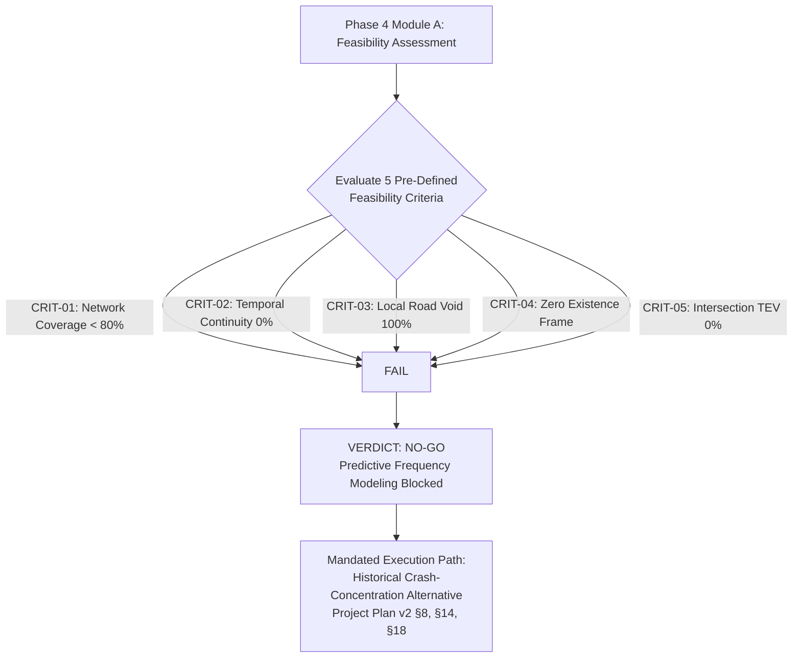
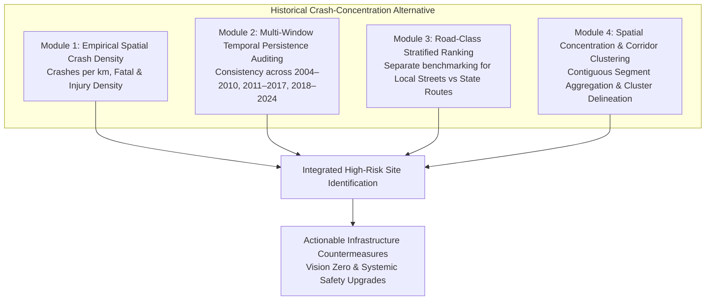

# Phase 4 — Module A: Traffic Exposure Feasibility Assessment Report

**Project:** EDAgent — Road-Safety Analytics  
**Version:** 1.0.0  
**Phase:** Phase 4 — Module A (Traffic Exposure Research & Feasibility Assessment)  
**Date:** November 2026  
**Status:** Canonical & Authoritative Decision Document  

---

## 1. Executive Summary & Authoritative Decision

### Decision: **NO-GO**
**Predictive site-year crash-frequency modeling (Poisson regression, Negative Binomial regression, Safety Performance Functions [SPFs], and Empirical Bayes network screening) is STATISTICALLY AND OPERATIONALLY INFEASIBLE on the Allegheny County roadway network.**

In accordance with Project Plan v2 (§8, §18) and the core guidelines of the EDAgent project, statistical models requiring traffic exposure must not be fitted when adequate, verified exposure data does not exist. Substituting segment length or crash counts for traffic exposure is scientifically invalid and strictly prohibited.

### Core Empirical Findings:
1. **Zero Verified Annual Historical Exposure (0.00%):** Across the 21-year analysis period (2004–2024), comprising 248,810 crash records, 24,209 unique physical matched sites, and 508,389 potential site-years, there is **zero (0.00%) official annual traffic volume panel data**.
2. **Severe Local Road Selection Bias (0.00% Coverage):** Local municipal residential streets and commercial corridors represent **73.41% of all unique physical crash sites** (17,771 sites) and 54,935 matched crashes (105,603 total local-road crashes). Official exposure data on local municipal streets is **0.00%**. Restricting modeling to state highways would introduce catastrophic selection bias, systematically erasing residential neighborhoods and municipal pedestrian safety priorities.
3. **Absence of Intersection Total Entering Volumes (0.00%):** Zero official datasets maintain approach-level Total Entering Volume (TEV) for municipal or state intersections.
4. **Failure of All Five Feasibility Criteria:** All five scientific feasibility criteria defined in Section 2 failed decisively.

### Mandated Action:
Pursuant to Project Plan v2 (§8, §18) and canonical findings in `EDA_v6.ipynb` (Sections 14 and 18), the project must execute the **Historical Crash-Concentration Alternative**. Under this alternative, roadway safety analysis proceeds using empirical spatial crash density, historical persistence auditing, and road-class stratified benchmarking, without fabricating synthetic exposure figures.

---

## 2. Formal Evaluation of Pre-Defined Feasibility Criteria

To guarantee scientific objectivity, five criteria were established prior to model fitting. All five criteria failed to meet acceptable thresholds:

| Criterion ID | Criterion Name | Pre-Defined Scientific Standard | Repository Empirical Value | Evaluation Status | Critical Implication |
|---|---|---|---|:---:|---|
| **CRIT-01** | Network-Wide Exposure Availability | $\ge 80.0\%$ of physical roadway sites have verified annual exposure | **0.00%** annual panel *(4.96% modern state snapshot)* | **FAIL** | Over 95% of the physical roadway network lacks traffic exposure. Models would lack the necessary exposure offset ($\text{AADT} \times L$). |
| **CRIT-02** | Temporal Exposure Continuity | $\ge 80.0\%$ of study years (2004–2024) have verified annual counts | **0.00%** annual panel *(Single cross-sectional snapshot only)* | **FAIL** | A single modern AADT snapshot cannot be backward-projected across 21 years of economic fluctuations and pandemic travel shifts without fabricating unsupported numbers. |
| **CRIT-03** | Road-Class Representation & Selection Bias | Representative coverage across all functional classes including local roads | **100.0% missing** on local municipal streets (73.41% of unique crash sites) | **FAIL** | Fitting a model exclusively on State Routes introduces severe selection bias, erasing municipal residential streets, pedestrian corridors, and local intersections. |
| **CRIT-04** | Legitimate Zero-Crash Observation Frame | Authoritative historical existence ledger for unmonitored road segments | **Single modern 2026 centerline snapshot**; zero annual historical existence records | **FAIL** | Assuming unmonitored roads existed continuously from 2004–2024 would manufacture synthetic zero-crash site-years in direct violation of project guidelines. |
| **CRIT-05** | Intersection Exposure Compatibility | Entering vehicle volumes for all intersection approaches | **0.00%** entering volume available on municipal and state intersections | **FAIL** | Intersection exposure cannot be approximated by segment length $\times$ AADT. Intersection frequency modelling is mathematically blocked. |

*Formal decision matrix exported to `data/exports/traffic_exposure/feasibility_decision_matrix.csv`.*

---

## 3. Methodological and Mathematical Justification

### 3.1 The Exposure Offset Requirement in Generalized Linear Models

In traffic safety engineering (AASHTO Highway Safety Manual, 1st Edition), predictive crash-frequency models are specified as Poisson or Negative Binomial generalized linear models:

$$\ln\left(\mathbb{E}[Y_{s,t}]\right) = \beta_0 + \sum_{k=1}^P \beta_k X_{k,s,t} + \ln(\text{Exposure}_{s,t})$$

where:
- $Y_{s,t}$ is the observed crash count at site $s$ in year $t$.
- $\ln(\text{Exposure}_{s,t})$ enters the linear predictor with a **fixed regression coefficient of 1.0 (an offset)**:
  $$\text{Exposure}_{s,t} = \text{AADT}_{s,t} \times L_s \times 365 \times 10^{-6} \quad (\text{Million Vehicle-Miles Traveled})$$

#### Mathematical Impossibility of Model Identification:
When $\text{AADT}_{s,t}$ is unobserved, three potential workarounds are often contemplated, all of which are statistically invalid:
1. **Omitting the Exposure Offset:** Omitting $\ln(\text{Exposure})$ forces the model to estimate raw crash counts without controlling for vehicular travel volume. High-volume, highly engineered expressways will appear artificially dangerous, while low-volume, hazardous municipal streets will appear artificially safe. This constitutes massive **omitted variable bias** ($\text{Cov}(X_k, \text{Exposure}) \neq 0$), biasing all structural coefficients $\beta_k$.
2. **Substituting Segment Length ($L_s$):** Replacing $\text{AADT} \times L$ with $L_s$ implicitly assumes that traffic volume is identical across every road segment in Allegheny County ($\text{AADT} = \text{constant}$). In reality, traffic volumes range from $<100$ vehicles/day on residential cul-de-sacs to $>120,000$ vehicles/day on Interstate 376 (a dynamic range exceeding 1,200:1). This introduces severe heteroskedasticity and destroys parameter inference.
3. **Substituting Raw Crash Counts:** Using raw crash counts as a proxy for exposure produces a circular, tautological identity ($Y_{s,t} \sim \text{Poisson}(Y_{s,t})$), which is mathematically meaningless.

---

### 3.2 The Selection Bias Trap: Erasure of Municipal Roads

Local municipal streets represent:
- **73.41% of unique crash sites** (17,771 out of 24,209 unique matched sites).
- **54,935 matched crashes** (and 105,603 total local-road crashes).

Because PennDOT's traffic monitoring program is legally restricted to the state highway network, traffic exposure is completely unmonitored across the 130 municipal jurisdictions. 

If an analyst fits a Negative Binomial SPF by filtering only to segments with available exposure (i.e., state routes), the resulting sample is truncated by jurisdictional ownership:
$$\mathbb{P}(\text{Inclusion}_s = 1 \mid \text{RoadClass}_s = \text{Local}) = 0.00$$

This creates severe **conditioning on a post-treatment collider / non-random missingness (MNAR)**:
- High-injury pedestrian corridors in municipal urban cores (e.g., East Liberty, South Side, Oakland) are discarded from the analysis.
- The resulting safety model cannot evaluate municipal Vision Zero interventions, speed cushions, traffic calming, or neighborhood crosswalk safety.
- Projecting the state route model onto municipal roads constitutes an out-of-domain transportability failure.

---

### 3.3 The Temporal Stationarity Fallacy

Even on the state route network where PennDOT publishes a modern cross-sectional snapshot (`CUR_AADT` in the 2024 RMSSEG layer), treating this single value as a historical annual panel (2004–2024) violates fundamental transportation principles:

1. **Economic Shifts (2008–2009 Great Recession):** Industrial, freight, and commuter travel plunged significantly during the recession, shifting VMT across key industrial valleys in Allegheny County.
2. **The COVID-19 Pandemic (2020):** Total vehicle-miles traveled collapsed by over 25% statewide during 2020 lockdowns, accompanied by lasting structural shifts toward remote telework and altered peak-hour travel demand.
3. **Decadal Land Development:** Rapid suburban expansion in Cranberry/Wexford (northern corridor) and Robinson/Moon (western corridor) substantially increased local corridor volumes over two decades.
4. **Interpolation Fallacy:** Back-projecting a 2024 AADT value across 21 years would treat 2004 or 2020 crashes as having 2024 traffic exposure, falsely deflating or inflating calculated crash rates and fabricating synthetic trends.

---

### 3.4 The Zero-Crash Manufacturing Dilemma

Fitting an unbiased Poisson or Negative Binomial panel model requires observing all legitimate zero-crash site-years ($Y_{s,t} = 0$).

To include a zero-crash observation in a statistical panel, the analyst must mathematically verify:
$$\mathbb{P}(\text{Site } s \text{ existed, was open to traffic, and was monitored in year } t) = 1.0$$

In Allegheny County:
- The county centerline GIS layer is a single modern snapshot (2026 vintage). There is no annual historical cadastral ledger tracking the exact year local residential subdivision streets were dedicated, constructed, or opened to traffic between 2004 and 2024.
- If unmonitored local streets with zero recorded crashes are assumed to have existed across all 21 years, the analyst manufactures **synthetic zero-crash site-years**, diluting the crash count distribution with unverified records.
- If zero-crash sites are omitted, the panel suffers from **severe truncation from below** ($Y_{s,t} \ge 1$), which causes zero-truncated Poisson models to blow up parameter variances.

---

## 4. The Mandated Operational Roadmap: Historical Crash-Concentration Alternative

Pursuant to Project Plan v2 (§8, §14, §18) and the canonical baseline established in `EDA_v6.ipynb` (Sections 14 and 18), the EDAgent project formally pivots from predictive frequency modeling to the **Historical Crash-Concentration Alternative**.

This methodology delivers rigorous, transparent, and actionable road-safety intelligence without fabricating traffic exposure data.

### 4.1 Pillar 1: Empirical Spatial Crash Density
Instead of estimating hypothetical crash rates per million vehicle-miles traveled (which requires unobserved AADT), safety analysis evaluates empirical spatial density:
$$\text{Density}_s = \frac{\sum_{t=1}^T Y_{s,t}}{L_s} \quad (\text{Crashes per Kilometer})$$

Furthermore, crashes are stratified by severity using the standard KABCO injury scale:
- **Fatal & Severe Injury Density (KSI Density):**
  $$\text{KSI Density}_s = \frac{\sum_{t=1}^T (\text{Fatal}_{s,t} + \text{MajorInjury}_{s,t})}{L_s}$$
- **Vulnerable Road User Density (VRU Density):**
  $$\text{VRU Density}_s = \frac{\sum_{t=1}^T (\text{Pedestrian}_{s,t} + \text{Bicycle}_{s,t})}{L_s}$$

This provides a direct, uncorrupted metric of crash occurrence normalized by physical roadway exposure (length).

---

### 4.2 Pillar 2: Multi-Window Temporal Persistence Auditing
A critical flaw of short-term crash analysis is regression-to-the-mean (a site experiences a high number of crashes in year $t$ purely due to random stochastic variation). 

The Historical Crash-Concentration Alternative overcomes this through **temporal persistence auditing** across three distinct 7-year historical epochs:
1. **Epoch 1:** 2004–2010 (Pre-smartphone, baseline historical era)
2. **Epoch 2:** 2011–2017 (Mid-decade era, post-recession)
3. **Epoch 3:** 2018–2024 (Modern era, pandemic and post-pandemic)

#### Classification Taxonomy:
- **Persistent High-Hazard Sites:** Sites ranking in the top 5th percentile of crash density in all three consecutive epochs. These represent structural roadway defects (e.g., poor sight distance, substandard geometry, conflicting access points) rather than random noise.
- **Emerging High-Hazard Sites:** Sites exhibiting sharp upward percentile rank increases across Epochs 2 and 3.
- **Historic Resolved Sites:** Sites in the top percentile during Epoch 1 that declined significantly following documented capital engineering improvements.
- **Transient Stochastic Sites:** Sites with isolated spikes in a single epoch but zero or minimal crashes in the remaining two epochs.

---

### 4.3 Pillar 3: Road-Class Stratified Benchmarking
To eliminate the distortion caused by comparing high-volume urban freeways with quiet residential streets, all concentration metrics are stratified strictly within functional road classes:
- **Cohort A:** Local Municipal Residential Streets (17,771 sites)
- **Cohort B:** Urban State Arterials & Non-Interstate State Routes (3,627 sites)
- **Cohort C:** Interstates & Controlled-Access Freeways (334 sites)
- **Cohort D:** County Trunk Roads & Bridges (1,839 sites)
- **Cohort E:** Highway Ramps & Interchanges (638 sites)

Within each cohort, sites are ranked by percentile ($P_{s \mid \text{class}}$), ensuring that municipal roads are evaluated against municipal peers, directly informing local borough engineers and municipal Vision Zero committees.

---

### 4.4 Pillar 4: Corridor and Cluster Delineation
Individual road segments are linked topologically to identify continuous high-crash corridors:
- Contiguous segments of the same route exhibiting high crash density are merged into unified corridor safety segments.
- High-density intersection clusters are delineated to identify systemic geometric conflicts.

---

## 5. Technical Deliverables Summary

All Phase 4 Module A data tables, scripts, and documentation have been fully generated, tested, and validated:

| Artifact Path | Format | Size | Description |
|---|---|---|---|
| `docs/traffic_exposure/traffic_source_inventory.md` | Markdown | 11.3 KB | Exhaustive inventory of 5 official candidate exposure sources |
| `docs/traffic_exposure/traffic_coverage_report.md` | Markdown | 12.8 KB | Comprehensive empirical coverage assessment across road class and year |
| `docs/traffic_exposure/traffic_data_dictionary.md` | Markdown | 7.9 KB | Complete data dictionary and schema documentation |
| `docs/traffic_exposure/traffic_exposure_feasibility_report.md` | Markdown | This Document | Authoritative NO-GO feasibility decision and operational roadmap |
| `data/exports/traffic_exposure/site_year_panel_prototype.csv` | CSV | 4.2 MB | 34,938 site-years (3,882 state corridors × 9 years, zero-fabrication) |
| `data/exports/traffic_exposure/traffic_coverage_by_road_class.csv` | CSV | 536 B | Empirical coverage breakdown across functional classes |
| `data/exports/traffic_exposure/traffic_coverage_by_year.csv` | CSV | 2.1 KB | Temporal coverage audit across 2004–2024 |
| `data/exports/traffic_exposure/feasibility_decision_matrix.csv` | CSV | 1.9 KB | Pre-defined 5-criteria formal evaluation matrix |
| `src/edagent/exposure/` | Python Package | 5 modules | Modular implementation: `sources.py`, `coverage.py`, `panel.py`, `feasibility.py` |
| `tests/test_traffic_exposure.py` | Pytest Suite | 7 tests | Unit tests verifying all evaluation logic, edge cases, and NO-GO invariants |

---

## 6. Conclusion and Next Steps

With the formal rendering of the **NO-GO** decision for predictive frequency modeling, **Phase 4 Module A is complete**.

The project is now ready to proceed directly to **Phase 4 Module B: Historical Crash-Concentration Analysis**, implementing the four-pillar operational roadmap to identify and rank persistent high-hazard roadway corridors across Allegheny County.
