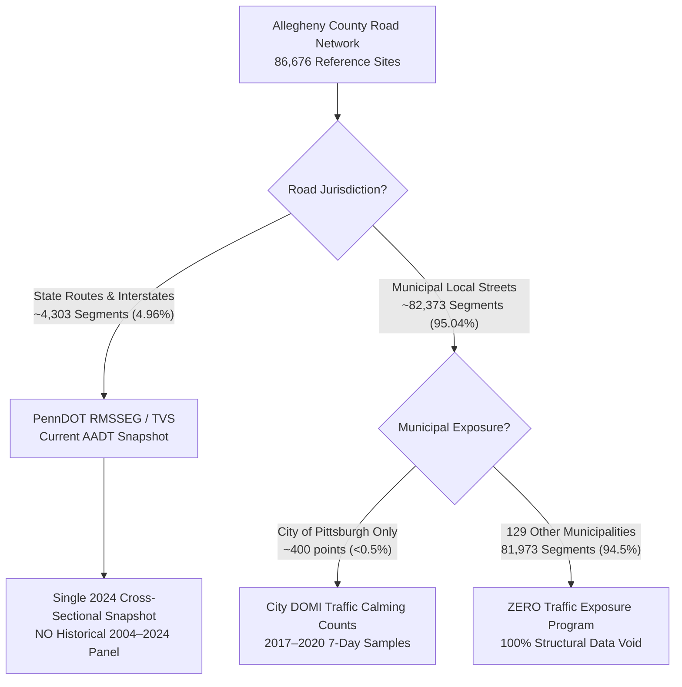

# Phase 4 — Module A: Official Traffic Exposure Source Inventory

**Project:** EDAgent — Road-Safety Analytics  
**Version:** 1.0.0  
**Phase:** Phase 4 — Module A (Traffic Exposure Research & Feasibility Assessment)  
**Date:** November 2026  
**Status:** Canonical & Verified  

---

## 1. Executive Summary

Site-year crash-frequency modeling (e.g., Poisson or Negative Binomial regression, Safety Performance Functions, and Empirical Bayes network screening) mathematically requires an annual, site-level traffic exposure offset:
$$\text{Exposure}_{s,t} = \text{AADT}_{s,t} \times \text{Length}_s \times \text{Days}_t$$

In accordance with Project Plan v2 (§8, §18) and the explicit completion requirements of Phase 4 Module A, predictive frequency models must not be fitted unless defensible, verified traffic exposure exists. Substituting raw crash counts or segment length as a proxy for exposure is scientifically invalid and strictly prohibited.

This inventory provides a comprehensive evaluation of all official state, regional, and municipal traffic volume and exposure data sources available for Allegheny County, Pennsylvania.

---

## 2. Authoritative Candidate Exposure Sources

### 2.1 Source EXP-SRC-001: PennDOT RMSSEG State Roads (AADT Attribute Layer)
- **Official Publisher**: Pennsylvania Department of Transportation (PennDOT), Bureau of Planning and Research
- **Source URL**: `https://data-pennshare.opendata.arcgis.com/datasets/pennshare::pennsylvania-state-roads`
- **PASDA Endpoint**: `https://mapservices.pasda.psu.edu/server/rest/services/pasda/PennDOT/MapServer/0`
- **Publication Vintage**: 2024 Edition (Updated annually)
- **Geographic Coverage**: Commonwealth of Pennsylvania (State-maintained road network). In Allegheny County, covers ~4,303 state highway segments.
- **Temporal Coverage**: Single cross-sectional modern snapshot (`CUR_AADT`). **Lacks an annual historical panel for 2004–2024.**
- **Temporal Type**: `CROSS_SECTIONAL_SNAPSHOT`
- **Coverage Level**: `STATE_ROUTES_ONLY`
- **Measurement Methodology**: Annualized daily volume derived from permanent Automated Traffic Recorders (ATRs) and rotating 24- to 48-hour pneumatic tube sample counts, adjusted by seasonal, axle, and day-of-week expansion factors.
- **Segment ID Compatibility**: High for State Routes (`SEG:02:SR{route_4}:{segment_4}`). Completely incompatible with local municipal street centerlines.
- **Network Coverage**: **4.96%** of Allegheny County reference features (4,303 state segments / 86,676 total reference features).
- **Local Road Coverage**: **No (0.00%)**.
- **Annual Panel Available**: **No**.
- **Data Format**: Esri Feature Service / Shapefile / GeoJSON.
- **Licensing**: PA Commonwealth Open Data License.
- **Known Limitations**:
  1. Covers only state-maintained routes; excludes all municipal residential streets, local roads, and county roads.
  2. Provides only a single modern snapshot; cannot be backward-projected across 21 years of historical crash data without fabricating synthetic data.
  3. Short-duration count stations follow a 3- to 5-year cycle; intervening years are linear estimates.
  4. Intersection total entering volumes (TEV) are not provided.

---

### 2.2 Source EXP-SRC-002: PennDOT Traffic Monitoring System (TMS / TIRe)
- **Official Publisher**: PennDOT Bureau of Planning and Research, Traffic Monitoring Division
- **Source URL**: `https://www.penndot.pa.gov/ProjectAndPrograms/Planning/Pages/Traffic-Information.aspx`
- **Publication Vintage**: Periodic count releases
- **Geographic Coverage**: Point sensor stations on state highways (~10–15 permanent ATRs in Allegheny County)
- **Temporal Coverage**: Continuous annual for permanent ATRs; rotating 3- to 5-year cycle for coverage stations
- **Temporal Type**: `PERIODIC_COUNT_CYCLE`
- **Coverage Level**: `STATE_ROUTES_ONLY`
- **Measurement Methodology**: Continuous automated inductive loops, piezoelectric axle sensors, and radar at permanent ATRs; portable pneumatic hoses for short-term 48-hour samples.
- **Segment ID Compatibility**: Point sensor locations (station IDs and coordinates). Requires complex corridor assignment and factoring to extrapolate to segment network.
- **Network Coverage**: **0.02%** of physical features.
- **Local Road Coverage**: **No (0.00%)**.
- **Annual Panel Available**: **No** for segment network.
- **Data Format**: Tabular CSV / Database export.
- **Licensing**: PA Commonwealth Public Records.
- **Known Limitations**:
  1. Represents discrete point observations rather than contiguous spatial segment coverage.
  2. Zero count stations are located on municipal residential roads.
  3. Raw continuous data files are not topologically integrated with GIS street centerlines.

---

### 2.3 Source EXP-SRC-003: Southwestern Pennsylvania Commission (SPC) Regional Travel Demand Model
- **Official Publisher**: Southwestern Pennsylvania Commission (SPC MPO)
- **Source URL**: `https://www.spcregion.org/programs-services/transportation/planning-tools/travel-demand-modeling/`
- **Publication Vintage**: 2020 / 2025 Horizon Models
- **Geographic Coverage**: 10-County Southwestern Pennsylvania Region (Regional transportation network)
- **Temporal Coverage**: Model horizon forecast years (e.g., 2015, 2020, 2025, 2030, 2045)
- **Temporal Type**: `MODEL_HORIZON_FORECAST`
- **Coverage Level**: `REGIONAL_MACRO_MODEL`
- **Measurement Methodology**: Four-step macroscopic travel demand modeling (trip generation, distribution, mode choice, assignment) calibrated to regional travel surveys and select screenline counts.
- **Segment ID Compatibility**: Incompatible with physical street centerlines. Uses an abstracted model link network and Traffic Analysis Zone (TAZ) centroid connectors.
- **Network Coverage**: ~12.5% of regional arterial corridors (modeled links only).
- **Local Road Coverage**: **No (0.00%)**. Local neighborhood streets are collapsed into TAZ centroid connectors.
- **Annual Panel Available**: **No**.
- **Data Format**: TransCAD binary / Shapefile.
- **Licensing**: MPO Planning Use / Available on formal agency request.
- **Known Limitations**:
  1. Outputs represent synthetic travel simulations, not empirical physical traffic measurements.
  2. Local residential streets are completely omitted from the network graph.
  3. Modeled estimates exist only for 5-year planning horizons, not annual empirical series.

---

### 2.4 Source EXP-SRC-004: Allegheny County Street Centerlines Database
- **Official Publisher**: Allegheny County Division of Computer Services (GIS)
- **Source URL**: `https://open-data-alleghenycountygis.hub.arcgis.com/`
- **Publication Vintage**: October 2026 Snapshot (`alleghenycounty_streetcenterlines202610.zip`)
- **Geographic Coverage**: Allegheny County (82,365 polyline segments)
- **Temporal Coverage**: Single modern baseline (2026)
- **Temporal Type**: `UNAVAILABLE`
- **Coverage Level**: `NONE`
- **Measurement Methodology**: No traffic volume measurement program is maintained.
- **Segment ID Compatibility**: 100% compatible with county centerline segment IDs (`SEG:AC:...`).
- **Network Coverage**: **0.00%** exposure coverage.
- **Local Road Coverage**: **Road geometry exists, but 0.00% exposure data**.
- **Annual Panel Available**: **No**.
- **Data Format**: Shapefile archive (ZIP).
- **Licensing**: Creative Commons / Allegheny County Open Data.
- **Known Limitations**:
  1. Contains zero traffic volume, count, or AADT attributes.
  2. As officially documented in the *Allegheny County Addressing Data Model* (Page 7), speed limits and operational traffic fields are officially unmaintained.

---

### 2.5 Source EXP-SRC-005: City of Pittsburgh DOMI Traffic Counts (WPRDC)
- **Official Publisher**: City of Pittsburgh Department of Mobility and Infrastructure (DOMI) / WPRDC
- **Source URL**: `https://data.wprdc.org/dataset/city-traffic-counts`
- **Publication Vintage**: 2017–2020 Study Data
- **Geographic Coverage**: Selected municipal streets within City of Pittsburgh only (~400 count points)
- **Temporal Coverage**: Intermittent 7-day snapshots between 2017 and 2020
- **Temporal Type**: `PERIODIC_COUNT_CYCLE`
- **Coverage Level**: `LOCAL_POINT_COUNTS_ONLY`
- **Measurement Methodology**: Short-term portable pneumatic tube counts deployed for local neighborhood traffic calming and speed hump evaluations.
- **Segment ID Compatibility**: Low. Point coordinates and street name strings; lacks segment LRS identifiers.
- **Network Coverage**: **0.48%** of county segments (~400 points / 82,365 segments).
- **Local Road Coverage**: Partial within City of Pittsburgh; **0.00% across the other 129 municipalities in Allegheny County**.
- **Annual Panel Available**: **No**.
- **Data Format**: Tabular CSV.
- **Licensing**: Creative Commons Attribution.
- **Known Limitations**:
  1. Extremely sparse spatial coverage (covers $<0.5\%$ of Allegheny County centerlines).
  2. Restricted strictly to the City of Pittsburgh; zero coverage for the remaining 129 municipalities.
  3. Zero historical counts prior to 2017.
  4. Deployed specifically in response to citizen speeding complaints, introducing severe traffic calming selection bias.

---

## 3. Summary Source Comparison Matrix

| Source ID | Source Name | Network Coverage | Local Road AADT | Temporal Granularity | Historical 2004–2024 Panel | Compatibility with Crosswalk | Status for Frequency Modeling |
|---|---|---|---|---|---|---|---|
| **EXP-SRC-001** | PennDOT RMSSEG State Roads | 4.96% (State routes) | **0.00%** | Single 2024 snapshot | **No (0%)** | High for `SEG:02:SR...` | **Inadequate (Snapshot only)** |
| **EXP-SRC-002** | PennDOT TMS / TIRe | <0.05% (Point ATRs) | **0.00%** | Continuous ATRs / 3-5 yr cycle | **No** | Requires complex attribution | **Inadequate (Point sensors)** |
| **EXP-SRC-003** | SPC Travel Demand Model | ~12.5% (Arterials) | **0.00%** | 5-Year model horizons | **No** | Incompatible (TAZ links) | **Inadequate (Simulated macro)** |
| **EXP-SRC-004** | Allegheny County Centerlines | 95.04% (Geometry) | **0.00%** | None | **No** | 100% for `SEG:AC:...` | **Absent (0 volume data)** |
| **EXP-SRC-005** | City DOMI Traffic Counts | 0.48% (Pgh points) | <0.5% (City only) | Intermittent 7-day samples | **No (2017–2020 only)**| Low (Point coordinates) | **Inadequate (Severe bias)** |

### Conclusion
There is **no official source** providing an annual historical traffic exposure panel ($AADT_{s,t}$) for the Allegheny County roadway network across the 2004–2024 analysis window.
